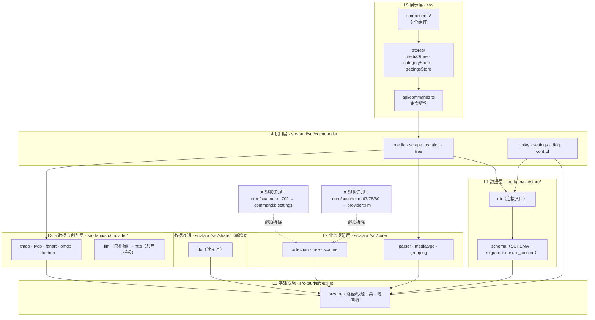

# media-manager 架构规划与任务分工（评审稿）

| 项 | 内容 |
| --- | --- |
| 文档用途 | 面向评审与排期：调研对比 → 架构说明 → 任务分工，**只做增量改造，不重写** |
| 编写 | 许清楚（产品调研）、高见远（架构与分工）、齐活林（汇编） |
| 日期 | 2026-10-04 |
| 代码基准 | 工作区 `G:\AI agent\media-manager` 当前工作树 |
| 上游文档 | `docs\开源影视管理项目调研与功能对比-2026-10-04.md`、`docs\影视管理软件架构设计与任务分工-2026-10-04.md` |
| 核心约束 | **绝不改变「录入 → 识别 → 刮削 → 分类标签 → 检索 → 详情 → 播放」主体主流程** |

---

## TL;DR

| # | 结论 |
| --- | --- |
| C1 | 主体主流程**全部保持**；改造集中在「检索质量、观看状态、元数据互通、扫描效率」四条增量线 |
| C2 | 代码核验发现两条比预期更严重的既成事实：`SourceHint`（R1）在生产环境 **100% 不生效**；`duration` **全库零写入**，R11 同样从未参与真实判定 |
| C3 | 存在**一处既成的分层违规**：`core/scanner.rs:702-703` 反向依赖 `commands::settings`，`:67/75/80` 横向依赖 `provider::llm`——必须先收口再加功能 |
| C4 | 四项决策：**不做**自动改名、**不做**内置播放器/转码（改做观看状态+连播）、**不启动**服务化/多用户、插件化**只做到「注册表 + Trait」** |
| C5 | 目标分层：`util ← store ← core / provider / share ← commands ← src`；`commands` 是唯一可同时使用下三层的层 |
| C6 | 主线 **72 人日 / 2 人 ≈ 7.2 周**；最大风险是「判定翻案」，不是技术选型 |

---

# 第一部分：功能对比

## 1.1 主流开源项目调研矩阵

> 下表「技术栈 / 定位 / 许可证」均取自核验日（2026-10-04）的官方仓库元数据或仓库内 manifest/LICENSE/README 原文。
> **Plex / Emby 边界**：Plex 服务端仓库返回 404，非开源，不作为调研对象；Emby 官方仓库 `MediaBrowser/Emby` 最后推送为 2024-03-27（停更约 2.5 年），stars 与用户量严重不匹配，判定为边界不清，改由 **Jellyfin** 承担「Emby 替代类」参照（弱证据，见 §1.4）。

| 项目 | 定位 | 核心功能模块 | 技术栈 / 架构取向 | 交互特点 | 可借鉴点 | 来源 |
| --- | --- | --- | --- | --- | --- | --- |
| **Jellyfin** | 自由软件媒体系统：专用服务端 + API + 多端客户端 | 库扫描与识别；多 provider 元数据；FFmpeg 转码；用户/权限/家长控制；**插件系统**；REST API + Swagger | C#/.NET；服务端与 `jellyfin-web` 严格分离；SQLite/PostgreSQL 可选 | Web 控制台 + 多端；一次录入全端消费；**播放历史与续播点**；SyncPlay | ① 关注点分离到 API/控制/实现三层；② 插件机制；③ **观看状态与续播点是标配**；④ 用户维度权限模型 | GPL-2.0，57,757★，末次推送 2026-10-04；`docs.jellyfin.org` |
| **tinyMediaManager** | 跨平台桌面媒体管理/清洗工具，生成 `.nfo` 与海报 | 多源刮削（IMDb/TMDB/TVDB/OFDb/…）；图源；预告片；字幕（OpenSubtitles）；**任意字段手工编辑**；**按模板自动改名**；**把元数据写成 .nfo**；**抽取 codec/时长/分辨率**；电影集 | Java（Maven）；GUI + CLI 双入口 | 桌面富客户端，面向「整理/清洗」而非「观看」 | ① **`.nfo` 是行业互通的持久化介质**；② 改名模板；③ 技术参数抽取；④ GUI+CLI 双入口 | GitLab，**Apache-2.0**（LICENSE 原文），257★，末次活动 2026-10-03 |
| **Kodi** | 开源家庭影院/媒体中心播放器，同时是媒体库引擎 | 指向媒体即自动扫描建库；播放列表/幻灯片；皮肤引擎；**Add-ons 为主要扩展机制** | C++ 为主，Add-on 多 Python；GPLv2 | 十尺/遥控器友好；全平台 | ① **元数据导入优先级约定**（本地 NFO → 在线刮削 → Local Info Only）；② 库本质是 SQLite；③ 本地 artwork 优先 | GPLv2，21,284★，末次推送 2026-10-04；`wiki.kodi.tv/view/NFO_files` |
| **MediaElch** | Kodi 专用媒体管理器 | 电影/剧集/演唱会/音乐元数据存储为 `.nfo`；自动下载 fanart.tv 美术 | C++；LGPL-3.0 | Kodi 生态的离线整理器 | ① NFO 是 Kodi/Jellyfin/Emby/Plex 的最大公约数；② 媒体类型可扩展（不只电影/剧集） | LGPL-3.0，1,113★，末次推送 2026-08-28 |
| **Stash** | 自托管 Web 应用，组织并服务个人内容集合 | 抓取信息；**社区插件扩展刮削来源**；标签组织与回找；Tags/Studios/Performers 统计 | Go；GraphQL(`gqlgen`) + `chi` + `sqlx`；JS runtime(`goja`)；**感知哈希**(`goimagehash`) | 浏览器 UI；先 Scanning 再策展；**社区 scraper 可在应用内安装更新** | ① **可插拔 provider 范式**；② 标签驱动检索；③ 感知哈希判相似；④ 统计视图 | AGPL-3.0，13,058★，末次推送 2026-10-01；`go.mod` |
| **Dim** | 自托管媒体管理器 | 媒体组织；Web UI 播放；FFmpeg 转码（vaapi） | **Rust workspace**（`dim-core/database/auth/events/extern-api/web`）；前端 React；需 ffmpeg+ffprobe | Native + Docker，Web UI 8000 | ① **与本项目最贴近的技术栈组合**；② 按领域切 workspace 的方式 | AGPL-3.0，4,121★；⚠️ **末次推送 2025-09-21，约 1 年无提交**，仅借鉴分层 |
| **MoviePilot** | NAS 媒体库自动化管理工具（中文生态） | 订阅/搜索/下载/整理/刮削/库刷新/通知；插件；工作流；AI Agent；MCP 端点 | FastAPI(Python) + Vue 3；SQLite/PostgreSQL；Docker 优先 | Web UI；可 daemon 常驻；REST API + MCP | ① **v3 自带 `native/fts5_cjk` —— 中文全文检索需专门分词（强证据）**；② 插件+工作流分层；③ API-first | GPL-3.0，11,821★，分支 `v3`，末次推送 2026-10-04 |
| **Sonarr / Radarr**（补充） | 面向 Usenet & BitTorrent 的组织管理器 | 剧集/电影组织与重命名；质量与命名规范 | C#，GPL-3.0 | 后台 daemon + Web UI | ① **重命名/整理模板**（本项目空白区）；② 与媒体服务器联动刷新 | GPL-3.0，16,770★ / 14,489★ |

### 跨项目共性（功能坐标系）

| 共性 | 说明 | 代表证据 |
| --- | --- | --- |
| 元数据回落有多源优先级 | 权威源 → 补充源 → 可选增强；缺才补、不覆盖 | 本项目 `provider/mod.rs` 已有同构约定；TMM 多源；Jellyfin 多 provider |
| 本地文件证据优先于远程猜测 | Kodi：本地 NFO → 在线刮削；本项目：结构证据 > 时长 | `wiki.kodi.tv/view/NFO_files`；`core/mediatype.rs` 头部注释 |
| `.nfo`（sidecar）是跨系统互通介质 | TMM/MediaElch 写；Kodi/Jellyfin/Emby/Plex 读 | 各项目 README / Kodi wiki |
| **观看状态 / 续播是资源管理的标配** | 「管理自己的影视库」与「只是文件列表」的分界线 | Jellyfin 文档；Stash 标签与统计 |
| 扩展性通常做成 provider 注册表 / 插件 | Stash 社区 scraper 在线装；Jellyfin 插件隔离加载；Kodi add-ons | 各项目 README / 插件生态 |
| 技术参数（codec/时长/分辨率）值得抽取进库 | TMM 明写 "extracted from each media file" | TMM README |
| **中文全文检索需要专门分词** | MoviePilot v3 自带 `native/fts5_cjk` | MoviePilot v3 仓库树 |
| API-first 是多端/自动化的前提 | Jellyfin / Stash / MoviePilot 均先有 API 再多端 | 各项目文档 |

## 1.2 当前软件现状（事实盘点）

| 维度 | 现状 | 证据 |
| --- | --- | --- |
| 外壳 | **Tauri 2** 桌面应用，Windows-only | `README.md` §一；`src-tauri/tauri.conf.json` |
| 后端 | Rust，**四层 + 两辅助**：`commands`/`core`/`provider`/`store`，外加 `boot`/`util` | `src-tauri/src/lib.rs:1-9` |
| 依赖 | `rusqlite`(bundled)、`walkdir`、`regex`、`ureq`、`serde`、`tauri-plugin-opener`、`tauri-plugin-dialog` | `src-tauri/Cargo.toml:50-73` |
| 前端 | Vue 3 + Pinia + Vite + TypeScript；Vitest + jsdom | `src/App.vue`；`package.json` |
| 持久化 | SQLite，**8 张表**，WAL + FK 级联，`user_version` **v5**；老库靠 `ensure_column` 增量补列 | `src-tauri/src/store/db.rs:21-225` |
| 网络暴露 | **无 HTTP 服务端**（无 server 框架依赖） | `Cargo.toml`；全仓检索 axum/actix/hyper/rocket/warp 零命中 |
| 文件监听 | 无 fs watcher | 全仓检索 `notify/inotify/watch(` 零命中 |

**已具备的能力（即「必须保持」清单的来源）**：扫描入库（后台线程 + 进度事件 + 可取消）、文件名解析（扩展名 + 文件头 magic number 兜底）、**R0–R12 多信号类型判定（Unknown 一等公民）**、剧集分组与二次校正 + `locked`、系列电影合集视图级去重、树形组织（`MAX_DEPTH=4` + 环/深校验 + 撤销）、六源刮削（TMDb→TVDB→Fanart→OMDb→豆瓣→LLM，LLM 只补漏）、分类/标签、详情编辑/新建、指定归属导入、外部播放器播放（PotPlayer 探测 + 回退）、双进度条任务反馈、本地优先（SQLite@`%APPDATA%`）、`boot.rs` 自愈与 `diag` 诊断。

## 1.3 逐项功能对比表（24 项）

> 状态取值：**现有**（已可用）/ **部分具备**（有但受限）/ **缺失** / **待优化**（有但已知问题）/ **必须保持**（主体主流程的一部分）

| # | 维度 | 外部参照 | 当前状态 | 判定 | 证据文件 | 说明 |
| --- | --- | --- | --- | --- | --- | --- |
| 1 | **资源录入（目录扫描入库）** | Jellyfin/TMM/Stash 均支持 | ✅ 已有 | **必须保持 + 待优化** | `core/scanner.rs:1-10`；`commands/media.rs`；`App.vue:306-326` | 待优化：每次全盘递归，无增量判定 |
| 2 | **扫描识别（文件名解析）** | TMM「任意组织风格都能导入」 | ✅ 已有且较强 | **必须保持** | `core/parser.rs:20-56`；`docs/Phase-G-改动说明.md` | 「宁缺勿滥」（`.dat` 刻意不收）原则应保留 |
| 3 | **类型判定（电影/剧集/待确认）** | 多数工具依赖在线源；本项目反其道以本地结构证据为主 | ✅ 已有（R0–R12） | **必须保持 + 待优化** | `core/mediatype.rs:1-77`、`:85-125` | 待优化：`SourceHint`（R1）**完全未接线**（见 §1.5） |
| 4 | **元数据刮削（多源 + 优先级）** | TMM/Jellyfin/Stash | ✅ 已有（六源） | **必须保持 + 待优化** | `provider/mod.rs:1-16`；各 provider；`README.md` §四b | 待优化：除 TMDb 外**无本地缓存**（README §八 第 3 条） |
| 5 | **元数据中文兜底** | MoviePilot / 中文场景 | ✅ 已有（豆瓣） | **必须保持 + 待优化** | `provider/douban.rs`；`docs/交接状态-2026-09-25.md` §16 | 待优化：非官方接口可能失效；豆瓣演员被截 12 人存进 `release_source`（字段语义借用，技术债） |
| 6 | **分类（category）** | Jellyfin Libraries；TMM filters | ✅ 现有 | **必须保持 + 待优化** | `db.rs:98-132`；`commands/catalog.rs` | 待优化：缺「从目录结构自动派生规则」 |
| 7 | **标签（tag）** | Stash 标签驱动组织与统计 | ✅ 现有 | **必须保持 + 待优化** | `db.rs:119-132`；`App.vue:229-239` | 待优化：只有名字+次数，无层级/颜色/别名/批量打标 |
| 8 | **检索（关键字）** | MoviePilot `fts5_cjk`；TMM 自定义过滤器 | ⚠️ 部分具备 | **待优化（核心缺口）** | `commands/media.rs:660-685`；`stores/mediaStore.ts` | LIKE 无分词，中文只能整串子串匹配；无 FTS5；无多条件组合筛选 |
| 9 | **树形组织（剧集层级）** | Kodi 季视图；Jellyfin Season/Episode | ✅ 现有（拖拽/另存为/撤销） | **必须保持 + 待优化** | `core/tree.rs`；`commands/tree.rs`；`SeriesTree.vue` | 待优化：撤销栈是进程内的（`lib.rs:47`），重启即失 |
| 10 | **详情编辑** | TMM「任意字段手工编辑」 | ✅ 现有 | **必须保持** | `MediaDetail.vue`；`MediaEditDialog.vue` | 可重新刮削/手动匹配/添加文件到本剧集，入口已补齐 |
| 11 | **播放** | Jellyfin 自带播放+转码；本项目走外部播放器 | ⚠️ 部分具备 | **必须保持 + 待优化** | `commands/play.rs:11-89`；`README.md` §一 | 待优化：只有单文件播放，无连播/下一集 |
| 12 | **观看状态 / 续播进度** | **Jellyfin 明载「播放历史与续播点」** | ❌ 缺失 | **待补（P0）** | 全仓检索 `resume/watch_history/播放位置` 零命中 | 最贴合的功能增量 |
| 13 | **任务反馈（进度/取消/结果）** | 各项目均作后台 Job | ✅ 现有 | **必须保持 + 待优化** | `commands/media.rs:26`；`commands/scrape.rs:63`；`App.vue:306-340` | 待优化：不是统一 Job 模型；自动刮削口径是「没有海报」 |
| 14 | **重复项 / 冲突处理** | TMM 版本去重；Stash 感知哈希 | ⚠️ 部分具备 | **待优化** | `db.rs:93`；`core/collection.rs:20-35`；`scanner.rs:38-47` | 去重只覆盖「同标题同年的电影」，剧集侧没有；无内容级哈希 |
| 15 | **离线 / 本地优先** | 本项目强项 | ✅ 现有 | **必须保持（不可弱化）** | `db.rs`；`Cargo.toml`；README §六 | 所有改造的底线 |
| 16 | **插件 / 扩展机制** | Stash/Jellyfin/Kodi | ❌ 缺失 | **待补（P2 前半）** | `provider/mod.rs:10-17`（编译期固定）；`lib.rs:54-124` | 新增数据源 = 改代码重新发版 |
| 17 | **权限 / 多用户** | Jellyfin 多用户+家长控制 | ❌ 缺失 | **视情况（P2，依赖服务化）** | `db.rs`（无 users 表） | 单机单人工具的合理缺失 |
| 18 | **跨设备 / 服务化** | Jellyfin/Stash/MoviePilot server-first | ❌ 缺失（**有意**） | **必须保持「默认关闭/可选」性质** | `tauri.conf.json`；无服务端 | 若将来加，必须可选开关 + 默认关闭 |
| 19 | **NFO / 数据互通** | TMM、MediaElch 核心能力；Kodi 库即 NFO+SQLite | ❌ 缺失 | **待补（P0）** | 全仓 `.nfo` 检索零命中 | 元数据锁在私有库，换机/换软件即归零 |
| 20 | **技术参数抽取（codec/分辨率/时长）** | TMM「extracted from each media file」 | ⚠️ 部分具备 | **待优化** | `db.rs`；`db.rs:200-201` 注释；见 §1.5 | `resolution` 仅 LLM 猜；`duration` **全库零写入** |
| 21 | **自动改名 / 整理** | TMM 改名模板；Sonarr/Radarr renamer | ❌ 缺失 | **P2（高危，本期不做）** | 全仓无 rename 实现 | 唯一会写用户真实磁盘的能力 |
| 22 | **字幕管理** | TMM（OpenSubtitles）；Jellyfin 插件 | ❌ 缺失 | **P2（不做）** | 全仓「字幕」仅作去噪词 | 外围能力 |
| 23 | **备份 / 恢复** | Jellyfin Backup and Restore | ⚠️ 部分具备 | **待优化（P1）** | 仅 `open_data_dir` + 打包脚本 | 单文件 SQLite 备份成本极低、收益高 |
| 24 | **健壮性 / 诊断** | 各家均有 | ✅ 现有（做得细） | **必须保持** | `boot.rs`；`commands/diag.rs` | 已是本项目的差异化优势 |

## 1.4 必须保持不变的核心主体功能（不可变边界）

| # | 边界 | 为什么 | 证据锚点 |
| --- | --- | --- | --- |
| **B1** | **主体主流程不得改变**：扫描/导入 → 文件名解析 → 类型判定 → 元数据刮削 → 分类标签 → 检索浏览 → 详情 → 播放 | 用户每天走的路径，改变等于重写产品 | `README.md` §四；`App.vue` 视图切换 |
| **B2** | **本地优先、单机桌面、默认无网络暴露** | 用户数据在自己机器上；不得引入强制联网或云依赖 | `db.rs`；`Cargo.toml`（无 server） |
| **B3** | **分层不反向依赖**：`core`/`provider`/`store` 互不依赖，只有 `commands` 同时使用三者 | 本仓最值钱的结构资产 | `lib.rs:1-9` |
| **B4** | **类型判定集中在 `core/mediatype.rs`，可配置；`Unknown` 一等公民；结构证据优先于时长/体积** | 历史多次误判的根因治理成果 | `core/mediatype.rs:1-77`；`core/parser.rs` |
| **B5** | **元数据 API 权威，LLM 只做脏文件名补漏，失败即回退** | README 明文承诺 | `README.md` §四b；`provider/mod.rs:1-8` |
| **B6** | **数据库只增量迁移，绝不重建库、绝不要求用户重新导入** | 用户库里有真实数据 | `db.rs:171-225`；5 个迁移单测 |
| **B7** | **既有的幂等/去重语义不得破坏**：`file_path` 唯一索引 upsert、`group_key`、`locked`、`source` | 否则重扫会冲掉用户手工整理结果 | `db.rs:89-95`、`:194-202`；`core/grouping.rs` |
| **B8** | **Tauri 命令契约与前端 store/组件结构不整体换掉** | 重构收益远低于风险 | `lib.rs:54-124`；`src/stores/*`；`src/**/*.spec.ts` |

## 1.5 代码核验发现（架构师亲验，比产品经理推断更严重）

> 这三条直接改写了 P0 的落地顺序，因此放在对比部分末尾而非架构部分。

| 编号 | 事实 | 证据 |
| --- | --- | --- |
| **D1** | **`SourceHint`（R1）在生产环境 100% 不生效**。枚举/`from_str`/`Signals` 字段/规则都在（`mediatype.rs:134-139`、`:143-150`、`:329`、`:604-619`），但**全仓库唯一赋值点是单测**（`core/tests/mediatype.rs:222`、`:227`）；三条生产喂信号路径 `scanner.rs:131-140`、`commands/media.rs:1329-1343`、`:1394-1402` 均未赋值 | 见证据列 |
| **D1 补充** | 更关键：**目前根本没有地方产生这个信号**。`scrape.rs:217-231` 的 `media_type` 是从库里读出的已定类型（当查询参数送给 TMDb），`update_meta()`（`:238-243`）不写 `type` 列——「TMDb 明明告诉我们这是剧集」这条权威信息既没回流 `core` 也没回流数据库 | 同上 |
| **D2** | **`duration` 全库零写入，R11 同样 100% 不生效**。扫描入库 4 条 INSERT 都不含 `duration`（`scanner.rs:450`、`:482`、`:504`、`:613`）；全仓检索 `duration =`/`SET duration` **0 命中**；`reclassify` 读它恒 None（`commands/media.rs:1195`/`:1208`/`:1330`）→ `classify` 的 R11 整段（`mediatype.rs:710-728`）永不进入。`resolution` 唯一来源是 LLM 猜且 `COALESCE` 首次写入即固化（`scrape.rs:778-784`） | 同上 |
| **D2 附带** | `provider/douban.rs:281` 是一条**过期注释**（声称存在「播放器/探测那条路」，实际不存在），建议 M0 顺手修正 | 同上 |
| **D3** | **存在一处既成的 B3 违规**：`core/scanner.rs:702-703` 调用 `crate::commands::settings::{load_llm_config, load_hosts}`（反向依赖上层），`:67/75/80` 调用 `crate::provider::llm`（横向依赖）。`lib.rs:1-3` 的承诺已被破两条 | 同上 |

## 1.6 增量机会清单（P0 / P1 / P2）

### P0（本次架构必须支持）

| ID | 机会 | 解决什么 | 借鉴 | 增量落地约束 |
| --- | --- | --- | --- | --- |
| **P0-0**（新增） | **R1 `SourceHint` 接线** | 类型判对是检索质量的上限 | — | 见 §1.5 D1；必须带 5 条 gate（禁止 `Tv → Movie`） |
| **P0-1** | **元数据结果本地缓存层** | README §八已列：非 TMDb 源无缓存，重复刮削重复请求 | TMM/Stash | 加在 `provider` 旁路；**不改 provider 函数签名与优先级顺序**；miss 行为与当前完全一致 |
| **P0-2** | **观看状态 + 续播** | 「看没看过」完全缺失 | Jellyfin 播放历史+续播点 | 新表 + 播放埋点；**不介入 `play_media` 的播放器选择与启动逻辑**；UI 只加角标与「继续播放」 |
| **P0-3** | **增量 / 差异化扫描** | 每次全盘递归，大库耗时 | Jellyfin/TMM 增量更新 | `scanner` 内加「未变更跳过」作为**前置过滤**；**保留全量路径作兜底**；排序/分组/二次校正一行不改 |
| **P0-4** | **检索升级：FTS5 + 中文分词** | LIKE 无分词，中文只能整串子串匹配 | MoviePilot `fts5_cjk` | FTS5 外部内容表（v5→v6 增量迁移）；查询侧**先取 FTS 与 LIKE 的并集**，失败/未建索引则回落现有 LIKE |
| **P0-5** | **NFO 读取 + 导出（双向）** | 元数据锁在私有库，换机/换软件即归零 | TMM/MediaElch/Kodi | 另起 `share/nfo` 模块（不进 `core`，不参与判定）；**导出先行**；导入的类型只作 `SourceHint` 候选并过 gate |

### P1（应尽快补，本期全做）

| ID | 机会 | 约束 |
| --- | --- | --- |
| **P1-1** | 统一任务模型（Job） | 在现有 `ScanControl`/`ScrapeControl` 之上抽象，先收拢事件与进度结构，不动业务逻辑 |
| **P1-2** | 标签体系加厚 + 批量操作 | 走 `ensure_column` 给 `tags` 加字段；批量打标复用既有 `selbar` |
| **P1-3** | 剧集侧的重复/副本检测 | 复用 `collection.rs` 的非破坏性语义，**不删数据** |
| **P1-4** | 备份 / 导出 / 恢复 | SQLite `VACUUM INTO`；**不改 `db::open` 路径** |
| **P1-5** | 跨根目录的同一剧集提示 | 保持不自动合并，只做「疑似重复」提示 |
| **P1-6** | 连播 / 下一集 | `play_media` 增加可选 `playlist` 参数，单次播放路径不变 |

### P2（有价值，可延后或需先确认）

| ID | 机会 | 本轮处理 |
| --- | --- | --- |
| **P2-1** | 可选只读本地 HTTP API | **不启动，仅预留**（默认关闭 + 127.0.0.1 + 无鉴权不启用） |
| **P2-2** | 多用户 / 权限 | **不做**，依赖 P2-1 |
| **P2-3** | provider 插件化 | **做一半**：注册表 + Trait + 配置开关，**不做动态加载/在线安装** |
| **P2-4** | ffprobe 抽取技术参数 | **做，但排最后且默认不参与判定**（见 §2.5） |
| **P2-5** | 内置播放 / 转码 | **不做**（见决策 ②） |
| **P2-6** | 字幕下载与管理 | **不做**，依赖 P2-4 |
| **P2-7** | 自动改名 / 整理 | **本期不做**，仅预留（见决策 ①） |
| **P2-8** | 跨平台（Linux/macOS） | **不做** |

## 1.7 来源可靠性

**强证据**（占绝大多数）：全部通过 GitHub/GitLab API 抓官方仓库元数据，或直接读仓库内 `LICENSE`/`Cargo.toml`/`go.mod`/`README.md` 原文，以及 Kodi wiki、docs.jellyfin.org。

**弱证据（需复核）**：

| 判断 | 依据 | 风险 |
| --- | --- | --- |
| Emby 不作为可比对象 | 仅依据仓库活跃度与 stars 反差推断 | 结论只影响「不引用 Emby」，不影响其他结论 |
| Jellyfin「resume points / 多用户 / SyncPlay」 | 来自文档站总述，未逐个核到 API 字段 | 用作「行业标配」层论据足够；据此做产品决策前需再核实 |
| PotPlayer 是否支持临时 `.m3u8` 播放列表 | 待实测 | 不支持则回退多文件传参，再不行降级为手动「下一集」 |
| bundled SQLite 是否含 FTS5 | **假设含**，M2 开工第一天必须实测 | 不含则降级为「应用层维护的索引表 + bigram 列 + LIKE 优化」 |

---

# 第二部分：架构说明

## 2.1 分层总览



**目标依赖方向**：`util ← store ← core / provider / share ← commands ← src`。`commands` 是唯一允许同时使用 `core` + `provider` + `share` + `store` 的层。

## 2.2 逐层设计

### L1 数据层 —— `src-tauri/src/store/`

| 项 | 内容 |
| --- | --- |
| **现状** | `db.rs`（512 行）一肩挑：SCHEMA + `migrate`(v1→v5) + `ensure_column` + `open` + 连接参数；已具备 WAL、FK 级联、`busy_timeout(10s)`（`db.rs:162-169`）、`user_version` v5、5 个迁移单测 |
| **目标形态** | `db.rs` 瘦身为**连接入口**（`open`/`db_path`/`data_dir`/`tables`）+ `pub use schema::*` 保证既有调用方零改动；拆出 `schema.rs`；新增 `playback.rs`、`cache.rs`、`search.rs`、`importer.rs`(P1) |
| **职责边界** | 只负责「怎么存、怎么取、怎么迁」。**不含**领域规则（不判定类型、不解析文件名）、**不含**网络/外部进程调用 |
| **依赖方向** | 只依赖 `util` + `rusqlite`；**不得依赖 `core`/`provider`/`commands`**（现存 `now_epoch` 被 `core` 反向引用 → 计划下沉 `util` 并 re-export 兼容） |
| **B6 守护** | 一律 `CREATE TABLE IF NOT EXISTS` + `ensure_column`；**禁止** `DROP TABLE`/重建库；`SCHEMA_VERSION` 5 → 6 |

### L2 业务逻辑层 —— `src-tauri/src/core/`

| 项 | 内容 |
| --- | --- |
| **现状** | `parser.rs`（扩展名 + magic number）、`mediatype.rs`（R0–R12 打分、可配置、Unknown 一等公民）、`grouping.rs`、`collection.rs`、`tree.rs`（`MAX_DEPTH=4` + 四类校验）、`scanner.rs` |
| **目标形态** | 六模块职责不变；`scanner.rs` **去掉对 `commands` 与 `provider` 的依赖**（LLM 增强改为调用方注入）；新增 `diff.rs`（增量指纹，纯函数）、`nfo.rs`（NFO → 结构化候选，纯函数，不碰 IO） |
| **职责边界** | 领域规则与算法，**全部是纯函数**。不得读配置表、不得发网络请求、不得调外部进程 |
| **B4 守护** | 判定规则**只写在 `core/mediatype.rs`**；`Unknown` 保留为 `MediaKind::default`；结构证据（R0）继续优先于时长/体积（R11 受压制）；新信号只能往 `Signals` 加字段 + 往 `classify` 加规则，**不得在别处另起一套判定** |

### L3 元数据与刮削层 —— `src-tauri/src/provider/`

| 项 | 内容 |
| --- | --- |
| **现状** | `mod.rs` 定义固定层次（TMDb 权威 → TVDB 季集 → Fanart 美术 → OMDb 评分 → 豆瓣 → LLM 兜底）与编译期固定的 `Providers`（`mod.rs:10-17`）；`http.rs` 共用样板；`llm.rs` 只解析脏文件名 |
| **目标形态** | 五源 + 层次不变；新增 `registry.rs`（Trait + 注册表 + 运行时开关）、`cache.rs`（`trait CacheBackend` + TTL，**不直接碰 Connection**）、`probe.rs`（ffprobe，可选）；`http.rs` 增可选缓存旁路（默认 `NoCache`） |
| **依赖方向** | `util`；需要持久化时通过**注入的 trait** 完成，**不静态依赖 `store`** |
| **B5 守护** | 权威顺序不因注册表化而改变；LLM 永远在 TMDb/TVDB/豆瓣之后且只在识别失败时启用；失败即回退 |

### L4 接口层 —— `src-tauri/src/commands/`

| 项 | 内容 |
| --- | --- |
| **现状** | `media.rs`、`scrape.rs`、`catalog.rs`、`tree.rs`、`play.rs`、`settings.rs`、`diag.rs`、`control.rs`；`lib.rs:54-124` 静态注册 40+ 命令 |
| **目标形态** | 新增 `playback.rs`、`share.rs`、`job.rs`(P1)、`probe.rs`(可选)；`play.rs` 增可选 `playlist` 与埋点；`scrape.rs` 增缓存注入与 R1 回写；`media.rs` 增增量扫描开关与 R1 接线 |
| **职责边界** | 唯一可同时使用下三层。负责命令外壳、并发/取消、事件推送、事务边界、**策略 gate**（如 R1 的 gate）、配置读取 |
| **B8 守护** | 既有命令名、参数顺序、返回结构一律不动；新能力走**新命令**或**追加可选参数**；`scan-progress`/`scrape-progress` 事件名保留 |

### L5 展示层 —— `src/`

| 项 | 内容 |
| --- | --- |
| **现状** | `api/commands.ts` + 3 个 store + 9 个组件 + `composables`/`utils`；`types.ts` 的 `ViewKey` 刻意用 `string` 避免硬编码枚举 |
| **目标形态** | 保持「api → stores → components」与 3+9 结构；新增 `playbackStore.ts`；`PosterCard.vue` 加观看角标、`MediaDetail.vue` 加「继续播放/标记已看」；`visibleItems()` 在 FTS 上线后降级为兜底 |
| **职责边界** | 只消费命令契约，不复制领域规则；类型判定真值只在 Rust |
| **B8 守护** | 不整体换结构；`App.vue` 的 `ViewKey`/`parseView` 语义不动 |

### L2.5 数据互通层 —— `src-tauri/src/share/`（新增同级模块，符合 B3）

| 项 | 内容 |
| --- | --- |
| **为什么单独一层** | NFO 既是「本地数据源」（读）又是「持久化介质」（写），塞进 `provider` 会让其承担写本地文件职责，塞进 `core` 会破坏纯函数性 |
| **职责** | Kodi/Jellyfin/TMM 兼容的 NFO 读写（电影 `movie.nfo`、剧集 `tvshow.nfo` + `season.nfo` + 单集 `.nfo`）、中文转义、`<episodeguide>` |
| **依赖方向** | `util` + `core` 的纯数据类型；**不依赖 `store`/`commands`** |
| **B4 守护** | NFO 解析出的**类型**不作为结论，只作 `SourceHint` 候选交 `commands` 过 gate；`title`/`year`/`tmdb_id`/`season`/`episode` 属本地结构证据，补给 `Signals` 既有字段（不新增判定通道） |

## 2.3 改造建议：逐项范围 / 优先级 / 风险 / 影响 / 验证

| ID | 机会 | 改动范围 | 优先级 | 风险 | 对现有流程的影响 | 验证方式 |
| --- | --- | --- | --- | --- | --- | --- |
| **P0-0** R1 接线 | `core/mediatype.rs`（摘 `allow(dead_code)`）、`commands/scrape.rs`（产出 `SourceHint`）、`commands/media.rs`（`reclassify` 推导）、两个测试文件 | **P0（最先）** | 中：无门槛启用会把正确剧集翻成电影 | 仅影响判定结果，不改流程 | 单测：`locked=1` 不改判、已有单集的 tv 行不改判、Unknown→Tv 生效、Tv→Movie 被拒 |
| **P0-1** 元数据缓存 | 新 `store/cache.rs`、`provider/cache.rs`(trait)、`provider/http.rs`(旁路)、`provider/mod.rs`、`commands/scrape.rs`、`commands/settings.rs`、schema v6 | **P0** | 中：缓存陈旧；key 设计不当会串数据 | **零**：miss 行为与当前完全一致，命中才省一次网络 | 单测：同 key 第二次不发起请求；断网后重复刮削同一条目仍成功 |
| **P0-2** 观看状态 | 新 `store/playback.rs`、`commands/playback.rs`、`play.rs`(埋点+连播)、`playbackStore.ts`、`PosterCard`/`MediaDetail`、schema v6 | **P0** | 中高：**无秒级进度来源**；连播依赖播放器 | **零**：不介入 `resolve_player` 与启动逻辑；角标是纯增量 UI | 单测 + 手工：播 3 集后重启，「继续播放」指向第 4 集；连播在装/未装 PotPlayer 两种环境均可起 |
| **P0-3** 增量扫描 | `core/scanner.rs`(指纹入口)、新 `core/diff.rs`、`commands/media.rs`(`full` 参数)、前端全量入口、schema 补 `file_mtime` | **P0** | **高**：误做成「只遍历变更文件」会破坏目录共识统计（触碰 B4） | 默认行为变化：重扫变快、`skipped` 增大；排序/分组/二次校正一行不改 | 单测：未变更→`skipped+1` 且不写库；**20 集中只改 1 集时目录共识统计仍基于全目录**；全量兜底可强制重写 |
| **P0-4** FTS5 + 中文 | 新 `store/search.rs`、schema v6(FTS5+触发器)、`commands/media.rs`(`LIST_WHERE` 分支)、`diag.rs`(能力探测)、`Cargo.toml`(`functions` feature) | **P0** | **高**：FTS5 是否编进 bundled SQLite 需实测；触发器写错影响所有写入路径 | 查询侧**先取 FTS 与 LIKE 的并集**；FTS 不可用 → 原样回落 LIKE，用户无感 | 单测：中文 bigram、大小写、年份、`%`/`_`/`\` 转义；**FTS 禁用时结果集与改动前逐条一致**；1500+ 条真实库手工对比 |
| **P0-5** NFO 互通 | 新 `share/mod.rs`+`share/nfo.rs`、`core/nfo.rs`、`commands/share.rs`；`commands/media.rs`(导入补给) | **P0（导出先行）** | 中：NFO 根元素若直接当结论会违反 B4；导入覆盖手工编辑 | 导出：只读库 + 写新文件，**不动库**；导入：类型只作 `SourceHint` 候选并过 gate | 单测：导出 XML 合法/中文转义；**导入 `tvshow.nfo` 但目录只有 1 个文件时不改判**；外部验证 Kodi/Jellyfin 可读（弱证据） |
| **P1-1** Job 统一 | 新 `commands/job.rs`；旧事件并行保留 | P1 | 低 | 先收拢事件与进度结构，不动业务逻辑 | 新 `job-progress` 与旧事件并行可用，前端订阅切换无感 |
| **P1-2** 标签加厚 | `schema.rs`（`ensure_column` 加 `color`/`alias`/`parent_id`）、`commands/catalog.rs`、前端复用 `selbar` | P1 | 低 | 不删列、不改唯一索引 | 批量打标可用；筛选下拉不变 |
| **P1-3** 剧集去重 | 扩 `core/collection.rs:20-35` 到 `tv` | P1 | 中 | 必须保持「不删数据」 | `duplicates` 视图新增 tv 记录，零删除 |
| **P1-4** 备份恢复 | `commands/share.rs`；`VACUUM INTO` | P1 | 低 | **不改 `db::open` 路径** | 备份文件可独立打开且条数一致 |
| **P1-5** 疑似重复提示 | 只提示，不自动动手 | P1 | 低 | 保持「跨根目录不合并」的有意为之 | 提示可关闭 |
| **P1-6** 连播 | `play.rs` 增可选 `playlist` | P1（并入 M1） | 中 | `playlist` 为空时**完整走原单文件路径** | 单文件 `play_media(path)` 行为与改动前完全一致 |
| **P2-3 前半** 注册表 | 新 `provider/registry.rs`；`Providers` → `Vec<Box<dyn MetadataProvider>>` | P2（M5/M6） | 中 | **优先级语义完全不变**；LLM 不进注册表 | 关闭任一 provider 后其余层次顺序不变 |
| **P2-4** ffprobe | 新 `provider/probe.rs`、`commands/probe.rs` | P2（M6，最后） | **高** | 见 §2.5：默认只填字段、R11 不生效 | 离线翻案报告产出；R11 未显式打开时判定结果与 M5 完全一致 |

## 2.4 四个关键决策

### 决策 ① 自动改名 / 整理：**本期不做**

| 维度 | 判断 |
| --- | --- |
| 理由 | ① **唯一会写用户真实磁盘**、误操作不可逆；② 本项目定位是「管理/检索/看」而非「整理/清洗」，README §四 主流程没有这一环（B1）；③ 无用户诉求证据；④ 改名会让 `file_path` 变动，直接冲击 B7 的 `ON CONFLICT(file_path)` upsert 与 `group_key` 派生 |
| 但要预留 | 把散在 `core/scanner.rs:450/504/613`、`commands/media.rs:1412`、`commands/tree.rs:301` 等处的 `file_path` 写入**收敛到单点** `store::paths::rename_file_path(conn, old, new)`（本期只收敛、不改行为）。将来 dry-run 与撤销日志只需挂这一处 |
| 若将来要做的前提 | 显式开关默认关闭 + dry-run 必经 + 默认不改目录结构 + 完整撤销日志 + 走统一 Job 可中断 |

### 决策 ② 内置播放器 / 转码：**不做。改做「观看状态 + 集级续播 + 连播」**

| 维度 | 判断 |
| --- | --- |
| 为什么不做 | ① 要引入解码栈，包体从几十 MB 跳到几百 MB，且当前 Windows-only 打包链要重写；② 转码需硬件加速适配，长期维护黑洞；③ B1 的「播放」语义是「调用外部播放器」，换成内置会改变主流程；④ 与竞品差距最大 ≠ 用户最需要 |
| 为什么观看状态才是分水岭 | 见对比表第 12 项：这是「管理自己的影视库」与「只是文件列表」的分界线，**成本只有内置播放器的十分之一** |
| 本期实现 | 集级进度（看到第几季第几集）+ 已看/未看 + 最近播放时间 + 播放次数；「继续播放」= 播下一未看集；连播走临时 `.m3u8`（回退多文件传参）；详情页可手动修正「看到第几集」 |
| **明确不做（诚实口径）** | **秒级 `position_secs` 自动记录**：外置 PotPlayer 无法回传进度。字段在 v6 预留，**不写进验收口径** |
| 复核触发 | 用户明确表达「想在本软件里直接看 / 想投屏」→ 再评估 |

### 决策 ③ 服务化 / 多用户：**本期不启动，仅零成本预留**

维持「`commands` 层函数 = 纯逻辑 + `Connection`，命令外壳只做并发与事件」（当前大体已成立）。**明确不做**：不提前引入 axum/actix/hyper，不建 `users` 表，不做鉴权。将来若要加：设置里显式开关 + 默认关闭 + 仅绑定 `127.0.0.1` + 无鉴权不启用 + 只读，并在 `diag.rs` 的 `runtime_info` 暴露监听状态。

### 决策 ④ 插件化：**只做到「注册表 + Trait + 配置开关」，不做动态加载**

本期：① `trait MetadataProvider`；② `Providers` 改为**编译期注册 + 运行时按设置过滤**的 `Vec<Box<dyn MetadataProvider>>`；③ 内置五源优先级顺序写进注册表配置，**不改语义**；④ 设置项可单独关闭某一源。
本期不做：动态库加载（`libloading`/`abi_stable`，Rust ABI 不稳定）、WASM 沙箱、应用内在线安装、第三方签名与权限模型。
理由：动态加载的工程量 ≈ 前面所有 P0 之和，而当前痛点**一个都不需要插件**。LLM 不进注册表，保持独立定位。

## 2.5 为什么 ffprobe（P2-4）必须最后做

`duration` 当前恒为 NULL ⇒ R11 **从未参与过任何一次真实判定**。一旦引入 ffprobe 并让 R11 生效：

- `duration ≥ 100 分钟` 且无剧集结构/命名证据的条目会凭空多出 `movie + 2`（`mediatype.rs:720-727`）。由于 `movie_threshold = 2`（`:252`），**这 2 分足以把一批 `Unknown` 直接翻成 `Movie`**——正是 `mediatype.rs:39-40` 明文要避免的「默默塞进电影」；
- 反过来 `duration ∈ [8,70] 分钟` 会 `tv + 2`，逼近 `tv_threshold = 3`，可能把短片/预告翻成 `Tv`。

顺序被钉死：

1. **M6 之前**：`resolution`/`duration` 只做字段填充，`Signals.duration_secs` 维持 `None`（R11 继续不生效）；
2. **M6 内部**：先探测入库，跑一次**离线对比**（对存量库用新字段跑 `classify`，只统计「会翻案多少条」，**不写库**）；
3. 翻案比例与样本交裁决后，才决定是否打开 R11（权重默认置 0 或加 `r11_enabled: bool`）；
4. 即便打开，也必须配合 `locked` 保护 + 显式 `reclassify`，**不自动重扫**。

## 2.6 模块划分与依赖关系

### 模块清单（32 个：新增 12 / 增强 11 / 保持 9）

| ID | 模块 | 层 | 类型 | 主要文件 | 说明 |
| --- | --- | --- | --- | --- | --- |
| M-01 | 连接与入口 | store | 增强（瘦身） | `store/db.rs`、`store/mod.rs` | re-export `schema::*` 保证零破坏 |
| M-02 | Schema 与迁移 | store | 新增（拆出） | `store/schema.rs` | SCHEMA + `migrate` + `ensure_column` + v6 |
| M-03 | 播放状态仓储 | store | 新增 | `store/playback.rs` | `playback_state` 读写、集级推进 |
| M-04 | 缓存仓储 | store | 新增 | `store/cache.rs` | `provider_cache` + `CacheBackend` 实现 + TTL |
| M-05 | 检索索引 | store | 新增 | `store/search.rs` | FTS5 建表/同步/查询 + bigram + LIKE 回退 |
| M-06 | 导入写入器 | store | 新增（P1） | `store/importer.rs` | 承接入库 SQL，让 `core` 彻底纯函数化 |
| M-07 | 文件名解析 | core | 保持 | `core/parser.rs` | 一行不改 |
| M-08 | 类型判定 | core | 增强 | `core/mediatype.rs` | 摘 `allow(dead_code)`；规则与 `Unknown` 语义不变 |
| M-09 | 分组与二次校正 | core | 保持 | `core/grouping.rs` | 一行不改 |
| M-10 | 系列电影合集 | core | 保持 | `core/collection.rs` | P1-3 在此扩到 tv |
| M-11 | 剧集层级树 | core | 保持 | `core/tree.rs` | 一行不改 |
| M-12 | 扫描编排 | core | 增强（去违规） | `core/scanner.rs` | 拆掉 `commands`/`provider` 依赖；加指纹入口 |
| M-13 | 增量指纹 | core | 新增 | `core/diff.rs` | `(path, size, mtime)` → `changed: bool` 纯函数 |
| M-14 | NFO 领域模型 | core | 新增 | `core/nfo.rs` | NFO 字段 → 结构化候选（纯，不碰 IO） |
| M-15 | 元数据五源 | provider | 保持 | `provider/{tmdb,tvdb,fanart,omdb,douban}.rs` | 签名与优先级不动（B5） |
| M-16 | LLM 补漏 | provider | 保持 | `provider/llm.rs` | 定位不动 |
| M-17 | HTTP 样板 | provider | 增强 | `provider/http.rs` | 增可选缓存旁路，默认关闭 |
| M-18 | provider 注册表 | provider | 新增 | `provider/registry.rs` | Trait + 编译期注册 + 运行时开关 |
| M-19 | 缓存策略 | provider | 新增 | `provider/cache.rs` | `CacheBackend` trait + TTL 分级 |
| M-20 | 技术参数探测 | provider | 新增（可选） | `provider/probe.rs` | ffprobe 调用与 JSON 解析 |
| M-21 | NFO 读写 | share | 新增 | `share/mod.rs`、`share/nfo.rs` | Kodi/Jellyfin/TMM 兼容 |
| M-22 | 媒体命令 | commands | 增强 | `commands/media.rs` | 增量扫描开关、R1 接线、FTS 分支 |
| M-23 | 刮削命令 | commands | 增强 | `commands/scrape.rs` | 缓存注入、R1 回写 |
| M-24 | 播放命令 | commands | 增强 | `commands/play.rs` | 埋点 + 可选连播 |
| M-25 | 观看状态命令 | commands | 新增 | `commands/playback.rs` | 标记已看/未看、集级进度、继续播放 |
| M-26 | 互通命令 | commands | 新增 | `commands/share.rs` | NFO 导入导出、备份恢复 |
| M-27 | 任务模型 | commands | 新增（P1） | `commands/job.rs` | 统一进度事件（旧事件并行保留） |
| M-28 | 诊断 | commands | 增强 | `commands/diag.rs` | 暴露 schema 版本 / FTS5 可用性 / 索引健康 |
| M-29 | 前端契约 | src/api | 增强 | `src/api/commands.ts` | 增量命令与类型 |
| M-30 | 播放状态 store | src/stores | 新增 | `src/stores/playbackStore.ts` | — |
| M-31 | 媒体 store | src/stores | 增强 | `src/stores/mediaStore.ts` | 全量重扫入口；`visibleItems` 降级为兜底 |
| M-32 | 组件 | src/components | 增强 | `PosterCard.vue`、`MediaDetail.vue` + 新增 `PlaybackBadge.vue`、`SearchFilterBar.vue`(P1) | 不改导航结构 |

### 依赖方向总表

| 依赖方 ↓ / 被依赖方 → | util | store | core | provider | share | commands |
| --- | :-: | :-: | :-: | :-: | :-: | :-: |
| **util** | — | ✗ | ✗ | ✗ | ✗ | ✗ |
| **store** | ✅ | — | ✗ | ✗ | ✗ | ✗ |
| **core** | ✅ | ⚠️ 收敛中（仅 `now_epoch`/入库 IO） | — | ✗（须拆） | ✗ | ✗（**须拆，现违规**） |
| **provider** | ✅ | ✗（持久化靠注入） | ✗ | — | ✗ | ✗ |
| **share** | ✅ | ✗ | ✅（只读纯类型） | ✗ | — | ✗ |
| **commands** | ✅ | ✅ | ✅ | ✅ | ✅ | — |

> ✅ 允许　✗ 禁止　⚠️ 既成事实，本期收敛、P1 彻底下沉

### 不破坏 B3 / B8 的硬护栏

| 风险点 | 护栏 |
| --- | --- |
| `core` 反向依赖 `commands`（**现已存在**：`scanner.rs:702-703`） | 把 `load_llm_config`/`load_hosts` 调用**上移到 `commands/media.rs`**，通过 `Option<&LlmEnhancer>` 注入 `core::scanner`；`verify.bat` 加检查：`grep -rn "crate::commands" src-tauri/src/core/` 期望 0 命中（测试目录除外） |
| `core` 横向依赖 `provider`（**现已存在**：`scanner.rs:67/75/80`） | `apply_llm_enhancement` 改为接受 `enhance: &mut dyn FnMut(&mut ScanFile) -> bool`；`provider::llm` 的调用搬到 `commands` |
| `core` 依赖 `store::db::now_epoch` | `now_epoch` 下沉 `util`，`store::db` 保留 `pub use` 兼容，所有调用方零改动 |
| `provider` 因缓存而依赖 `store` | 定义 `trait CacheBackend`，实现放 `store/cache.rs`，由 `commands` 注入；**`provider` 侧没有 `rusqlite`** |
| `share` 因写文件而依赖 `store` | `share/nfo.rs` 只做「结构体 ↔ 字节流」；读哪个目录、写回哪张表由 `commands/share.rs` 决定 |
| 新增模块破坏分层 | 新模块只落在既有层内，或作为**新增同级模块**（`share/`）；**不新增介于两层之间的模糊层** |
| 改动 Tauri 命令契约（B8） | ① 不改既有命令名与必填参数；② 新能力走新命令或**追加可选参数**；③ 返回结构只加字段不改字段 |
| 前端结构被整体换掉（B8） | 保持「api → stores → components」三段与 3 store + 9 组件；`App.vue` 的 `ViewKey`/`parseView` 语义不动 |

## 2.7 数据库 v6 增量迁移清单（B6：只增不建、绝不重建）

| 新增对象 | 用途 | 迁移方式 |
| --- | --- | --- |
| `media.file_mtime` / `episodes.file_mtime` | P0-3 增量指纹 | `ensure_column(... "INTEGER")` |
| `playback_state` 表 + `idx_playback_target` | P0-2 | `CREATE TABLE IF NOT EXISTS` + 唯一索引 `(media_id, IFNULL(episode_id,0))` |
| `provider_cache` 表 + `idx_provider_cache_exp` | P0-1 | `CREATE TABLE IF NOT EXISTS` |
| `media_fts`（FTS5 external content）+ 3 个触发器 | P0-4 | `CREATE VIRTUAL TABLE IF NOT EXISTS` + 触发器；**先探测 `pragma_compile_options` 是否含 `ENABLE_FTS5`，不含则整段跳过并回落 LIKE** |
| `tags.color` / `tags.alias` / `tags.parent_id` | P1-2 | `ensure_column` |
| `media.tech_json`（可选） | P2-4 实测参数 | `ensure_column`；**不参与判定** |

`SCHEMA_VERSION` 5 → 6；`migrate()` 结构保持不变，**既有 5 个迁移单测必须继续通过**，并至少新增：v5→v6 表齐全、v6 幂等、FTS5 缺失时迁移不失败、老数据行数不变。

## 2.8 开发里程碑

| 里程碑 | 目标 | 交付内容 | 验收口径 | 依赖 |
| --- | --- | --- | --- | --- |
| **M0 地基与合规收口** | 让后续改动落在干净分层上，做出 v6 迁移机制 | ① `store/schema.rs` 拆出 + `db.rs` re-export；② **拆除 `core→commands`/`core→provider` 反向依赖**；③ `now_epoch` 下沉 `util`；④ v6 迁移骨架（空迁移 + 版本位）；⑤ `verify.bat` 加分层检查 | ① 三件套全绿；② `core` 非测试代码对 `crate::commands`/`crate::provider` **0 命中**；③ v5 老库升 v6 后 8 张表与数据行数不变；④ 既有 5 个迁移单测全过 | 无（所有后续的前置） |
| **M1 R1 接线 + 观看状态** | 让 R1 真正生效；让「看没看过」进入产品 | ① R1 接线（含 5 条 gate）；② `playback_state` + `commands/playback.rs` + `playbackStore.ts` + 角标/继续播放；③ 连播 | ① `locked=1` 与已有单集的 tv 行不被改判；Unknown→Tv 生效；Tv→Movie 被拒；② 播 3 集后重启，「继续播放」指向第 4 集；③ 连播在装/未装 PotPlayer 两种环境均可起 | M0 |
| **M2 检索升级（FTS5 + 中文）** | 中文能分词、大库检索不退化 | `store/search.rs` + v6 FTS5 迁移 + 触发器 + bigram + `LIST_WHERE` 分支 + 能力探测 + 前端高级筛选(P1) | ① FTS 禁用时结果集与改动前**逐条一致**；② 启用时结果集 ⊇ LIKE（过渡期取并集）；③ 2 字中文词可命中；`%`/`_`/`\` 不越权；④ 1500+ 条真实库手工对比 | M0（**建议在 M1 之后**，因类型判对会提升检索质量） |
| **M3 缓存 + 增量扫描** | 重复刮削不再重复请求；重扫不再全量写库 | `provider/cache.rs` + `store/cache.rs` + `http.rs` 旁路 + `core/diff.rs` + 指纹过滤 + `file_mtime` + 全量兜底入口 | ① 同 key 第二次不发起网络请求；② 断网重复刮削仍成功；③ 未变更文件 `skipped+1` 且零写入；④ **20 集改 1 集时目录共识仍基于全目录、判定不变**；⑤ `locked`/`manual` 不被改写 | M0、M2 |
| **M4 NFO 互通 + 备份恢复** | 元数据不再锁死在私有库 | `share/nfo.rs` + `core/nfo.rs` + `commands/share.rs` + 备份（`VACUUM INTO`）+ 设置页入口 | ① 导出先做且**不改库**；② 导入 `tvshow.nfo` 但目录只有 1 个文件时**不改判**；③ 备份文件可独立打开且条数一致；④ 导出物能被 Kodi/Jellyfin 读（外部验证，弱证据） | M0、M1 |
| **M5 收尾：Job + 标签 + 去重 + 注册表** | P1 收口，为 P2 留口 | `commands/job.rs` + `tags` 扩展 + `collection.rs` 扩 tv + `provider/registry.rs` + `store/importer.rs` | ① 新 `job-progress` 与旧事件并行可用，前端订阅切换无感；② 关闭单个 provider 后其余层次顺序不变；③ `core` 不再出现入库 SQL | M1–M4 |
| **M6（可选）技术参数实测** | 让 `resolution`/`duration` 有真值 | `provider/probe.rs` + `commands/probe.rs` + 字段入库 | ① 先**只填字段、不进判定**；② 单独开关控制 R11；③ 抽样 100 个文件与播放器时长比对 | M5（**必须最后**） |

并行建议：T-03（前端重）与 T-04（Rust 重）可由两人分别主领；T-05 与 T-06 在 T-01/T-02 完成后可并行。

---

# 第三部分：结构化任务分工

> **工作量假设**：团队规模 **2 人**（1 人主 Rust / 1 人主前端，可互相支援），人日 = 单人有效工作日（已按 0.7 有效工时折算）。单人开发日历周期 ≈ 人日数；2 人并行 ≈ 人日数 / 2。

```json
[
  {
    "id": "T-01",
    "name": "架构合规收口与数据层地基（M0）",
    "modules": ["M-01","M-02","M-28"],
    "responsibility": "拆出 store/schema.rs 并让 db.rs re-export；拆除 core/scanner.rs 对 commands 与 provider 的反向依赖（LLM 增强层改为注入）；now_epoch 下沉 util；搭 v6 迁移骨架；verify.bat 加分层检查；diag.rs 暴露 schema 版本与健康检查",
    "files": [
      "src-tauri/src/store/db.rs",
      "src-tauri/src/store/schema.rs（新）",
      "src-tauri/src/store/mod.rs",
      "src-tauri/src/core/scanner.rs",
      "src-tauri/src/commands/media.rs",
      "src-tauri/src/util.rs",
      "src-tauri/src/commands/diag.rs",
      "verify.bat"
    ],
    "skills": ["Rust","rusqlite","Tauri 2","重构（保持外部行为不变）"],
    "effort": { "rust": 5, "frontend": 0, "total_人日": 5, "人周_2人": 0.5 },
    "dependsOn": [],
    "blocks": ["T-02","T-03","T-04","T-05","T-06"],
    "acceptance": "cargo test / vitest / tsc --noEmit 全绿；core 非测试代码对 crate::commands 与 crate::provider 零引用；v5→v6 升级后 8 张表与数据行数不变"
  },
  {
    "id": "T-02",
    "name": "R1 SourceHint 接线与判定 gate（M1）",
    "modules": ["M-08","M-22","M-23"],
    "responsibility": "摘掉 SourceHint 的 allow(dead_code)；在 scrape 命中分支与 apply_tmdb_match 产出 SourceHint；reclassify_library 从 tmdb_id/tvdb_id 推导；实现五条 gate 并写回 type；补单测",
    "files": [
      "src-tauri/src/core/mediatype.rs",
      "src-tauri/src/commands/scrape.rs",
      "src-tauri/src/commands/media.rs",
      "src-tauri/src/core/tests/mediatype.rs",
      "src-tauri/src/commands/tests/scrape.rs",
      "src-tauri/src/commands/tests/media.rs"
    ],
    "skills": ["Rust","领域规则建模","单测"],
    "effort": { "rust": 4, "frontend": 0, "total_人日": 4, "人周_2人": 0.4 },
    "dependsOn": ["T-01"],
    "blocks": ["T-03","T-04"],
    "acceptance": "locked=1 与已有单集的 tv 行不被改判；Unknown→Tv 生效；Tv→Movie 被 gate 拒绝；改判可追溯"
  },
  {
    "id": "T-03",
    "name": "观看状态、续播与连播（M1 · P0-2 + P1-6）",
    "modules": ["M-03","M-24","M-25","M-29","M-30","M-32"],
    "responsibility": "playback_state 表与仓储；mark_watched / set_progress / resume_target / play_playlist 命令；play.rs 埋点与可选 playlist（单文件路径不变）；前端 playbackStore + PosterCard 角标 + MediaDetail 继续播放/标记已看；预留 position_secs 字段但不自动采集",
    "files": [
      "src-tauri/src/store/playback.rs（新）",
      "src-tauri/src/commands/playback.rs（新）",
      "src-tauri/src/commands/play.rs",
      "src-tauri/src/store/schema.rs",
      "src-tauri/src/lib.rs",
      "src/api/commands.ts",
      "src/stores/playbackStore.ts（新）",
      "src/components/PosterCard.vue",
      "src/components/MediaDetail.vue",
      "src/components/PlaybackBadge.vue（新）"
    ],
    "skills": ["Rust","SQLite","Vue 3","Pinia","Vitest","Windows 播放器行为实测"],
    "effort": { "rust": 6, "frontend": 6, "total_人日": 12, "人周_2人": 1.2 },
    "dependsOn": ["T-01","T-02"],
    "blocks": ["T-08"],
    "acceptance": "重启后观看状态与集级进度保持；已装/未装 PotPlayer 两种环境连播均可起；单文件 play_media(path) 行为与改动前完全一致"
  },
  {
    "id": "T-04",
    "name": "检索升级 FTS5 + 中文分词（M2 · P0-4）",
    "modules": ["M-05","M-02","M-22","M-28","M-29","M-31"],
    "responsibility": "store/search.rs（bigram 展开、建表、触发器、查询、能力探测、LIKE 回退）；v6 迁移 FTS5 + 触发器；LIST_WHERE 增 FTS 分支（过渡期取并集）；Cargo.toml 增 rusqlite functions feature；前端高级筛选（P1，可选）",
    "files": [
      "src-tauri/src/store/search.rs（新）",
      "src-tauri/src/store/schema.rs",
      "src-tauri/src/commands/media.rs",
      "src-tauri/src/commands/diag.rs",
      "src-tauri/Cargo.toml",
      "src/api/commands.ts",
      "src/stores/mediaStore.ts",
      "src/components/SearchFilterBar.vue（新，P1）"
    ],
    "skills": ["Rust","SQLite FTS5","中文分词","增量迁移","Vue 3"],
    "effort": { "rust": 9, "frontend": 5, "total_人日": 14, "人周_2人": 1.4 },
    "dependsOn": ["T-01"],
    "blocks": ["T-05","T-08"],
    "acceptance": "FTS 缺失时结果集与改动前逐条一致；FTS 启用时结果集 ⊇ LIKE；2 字中文词可命中；% _ \\ 不越权；v5 老库升级触发器齐全"
  },
  {
    "id": "T-05",
    "name": "元数据缓存与增量扫描（M3 · P0-1 + P0-3）",
    "modules": ["M-04","M-12","M-13","M-17","M-19","M-22","M-31"],
    "responsibility": "CacheBackend trait + store 实现 + http.rs 旁路 + TTL 分级 + 清缓存入口；core/diff.rs 指纹比对；media.rs 指纹过滤（遍历仍全量、只过滤写入）+ full 全量兜底；file_mtime 列",
    "files": [
      "src-tauri/src/provider/cache.rs（新）",
      "src-tauri/src/store/cache.rs（新）",
      "src-tauri/src/provider/http.rs",
      "src-tauri/src/provider/mod.rs",
      "src-tauri/src/commands/scrape.rs",
      "src-tauri/src/commands/settings.rs",
      "src-tauri/src/core/diff.rs（新）",
      "src-tauri/src/core/scanner.rs",
      "src-tauri/src/commands/media.rs",
      "src-tauri/src/store/schema.rs",
      "src/api/commands.ts",
      "src/stores/mediaStore.ts"
    ],
    "skills": ["Rust","SQLite","ureq","文件系统（mtime/size）","Vue 3"],
    "effort": { "rust": 10, "frontend": 2, "total_人日": 12, "人周_2人": 1.2 },
    "dependsOn": ["T-01","T-04"],
    "blocks": ["T-08"],
    "acceptance": "同 key 二次请求不发起网络调用；断网重复刮削仍成功；未变更文件 skipped+1 且零写入；20 集改 1 集时目录共识与判定不变；locked/manual 不被改写"
  },
  {
    "id": "T-06",
    "name": "NFO 互通与备份恢复（M4 · P0-5 + P1-4）",
    "modules": ["M-14","M-21","M-26","M-29","M-31"],
    "responsibility": "share/nfo.rs 读写（Kodi/Jellyfin/TMM 兼容、中文转义、单集 NFO）；core/nfo.rs 结构化候选；commands/share.rs 导出/导入/备份（VACUUM INTO）；导入时类型只作 SourceHint 候选并过 gate；设置页入口",
    "files": [
      "src-tauri/src/share/mod.rs（新）",
      "src-tauri/src/share/nfo.rs（新）",
      "src-tauri/src/core/nfo.rs（新）",
      "src-tauri/src/commands/share.rs（新）",
      "src-tauri/src/commands/media.rs",
      "src-tauri/src/lib.rs",
      "src/api/commands.ts",
      "src/components/SettingsPanel.vue",
      "src/stores/mediaStore.ts"
    ],
    "skills": ["Rust","XML","Kodi NFO 规范","SQLite VACUUM INTO","Vue 3"],
    "effort": { "rust": 7, "frontend": 3, "total_人日": 10, "人周_2人": 1.0 },
    "dependsOn": ["T-01","T-02"],
    "blocks": ["T-08"],
    "acceptance": "导出不改库；导入 tvshow.nfo 但目录单文件时不改判；备份文件可独立打开且条数一致；导出物能被 Kodi/Jellyfin 读（外部验证，弱证据）"
  },
  {
    "id": "T-07",
    "name": "provider 可插拔注册表（M5 · P2-3 前半）",
    "modules": ["M-18","M-15","M-16"],
    "responsibility": "MetadataProvider trait + 编译期注册表 + 设置项开关；Providers 结构改为 Vec<Box<dyn MetadataProvider>> 但优先级语义完全不变；LLM 不进注册表",
    "files": [
      "src-tauri/src/provider/registry.rs（新）",
      "src-tauri/src/provider/mod.rs",
      "src-tauri/src/provider/tmdb.rs",
      "src-tauri/src/provider/tvdb.rs",
      "src-tauri/src/provider/douban.rs",
      "src-tauri/src/commands/scrape.rs",
      "src-tauri/src/commands/settings.rs"
    ],
    "skills": ["Rust（trait 对象 / 泛型）","架构抽象"],
    "effort": { "rust": 6, "frontend": 0, "total_人日": 6, "人周_2人": 0.6 },
    "dependsOn": ["T-05"],
    "blocks": [],
    "acceptance": "关闭任一 provider 后其余层次与顺序不变；内置五源行为与改动前一致；LLM 仍只在识别失败时启用"
  },
  {
    "id": "T-08",
    "name": "统一任务模型、标签加厚、剧集去重与 core 纯函数化（M5 收尾）",
    "modules": ["M-06","M-10","M-27","M-28","M-31","M-32"],
    "responsibility": "commands/job.rs 统一进度事件（旧事件并行保留）；tags 加 color/alias/parent_id + 批量打标；collection.rs 去重扩到 tv（非破坏性、只记不删）；疑似重复提示；store/importer.rs 承接入库 SQL 让 core 彻底纯函数",
    "files": [
      "src-tauri/src/commands/job.rs（新）",
      "src-tauri/src/commands/media.rs",
      "src-tauri/src/commands/scrape.rs",
      "src-tauri/src/commands/catalog.rs",
      "src-tauri/src/core/collection.rs",
      "src-tauri/src/store/importer.rs（新）",
      "src-tauri/src/core/scanner.rs",
      "src-tauri/src/store/schema.rs",
      "src/stores/mediaStore.ts",
      "src/components/MediaDetail.vue",
      "src/App.vue（仅事件订阅切换）"
    ],
    "skills": ["Rust","Vue 3","Pinia","Vitest"],
    "effort": { "rust": 7, "frontend": 3, "total_人日": 10, "人周_2人": 1.0 },
    "dependsOn": ["T-03","T-04","T-05","T-06"],
    "blocks": ["T-09"],
    "acceptance": "新 job-progress 与旧 scan/scrape-progress 并行可用且前端无感；去重不删任何数据行；core 非测试代码不再出现入库 SQL"
  },
  {
    "id": "T-09",
    "name": "技术参数实测与 R11 生效评估（M6 · 可选，P2-4）",
    "modules": ["M-20","M-22","M-28"],
    "responsibility": "provider/probe.rs 调 ffprobe 解析 JSON；commands/probe.rs 编排与节流；字段入库（先只填字段）；离线跑一遍 classify 统计「会翻案多少条」不写库；由裁决决定是否开关 R11",
    "files": [
      "src-tauri/src/provider/probe.rs（新）",
      "src-tauri/src/commands/probe.rs（新）",
      "src-tauri/src/commands/media.rs",
      "src-tauri/src/core/mediatype.rs",
      "src-tauri/src/store/schema.rs",
      "src-tauri/Cargo.toml",
      "src-tauri/tauri.conf.json（二进制随包）"
    ],
    "skills": ["Rust","ffprobe / FFmpeg 部署","Windows 打包","数据分析"],
    "effort": { "rust": 8, "frontend": 0, "total_人日": 8, "人周_2人": 0.8 },
    "dependsOn": ["T-08"],
    "blocks": [],
    "acceptance": "默认只填字段、R11 不生效；离线翻案报告产出；抽样 100 个文件与播放器时长比对通过；R11 开关未显式打开时判定结果与 M5 完全一致"
  }
]
```

## 3.1 工期汇总

| 口径 | 人日 | 2 人并行日历周 |
| --- | --- | --- |
| 主线（T-01 … T-06 + T-08） | **72** | ≈ **7.2 周** |
| 主线 + T-07（provider 注册表） | 78 | ≈ 7.8 周 |
| 全部（含可选 T-09 ffprobe） | **84** | ≈ **8.4 周** |

## 3.2 工程约定（跨任务共享）

| # | 约定 |
| --- | --- |
| 1 | 所有 Tauri 命令返回 `Result<T, String>`，错误文案直接给用户看（中文），沿用现有风格 |
| 2 | 新增数据库对象一律 `CREATE TABLE/INDEX/TRIGGER IF NOT EXISTS` 或 `ensure_column`；**禁止** `DROP`/重建库；`SCHEMA_VERSION` 每次结构变更 +1 |
| 3 | 所有时间戳为 Unix 秒（`i64`），来源于 `util::now_epoch()` |
| 4 | 新能力优先「新增命令」或「追加可选参数」，**不改既有命令名与必填参数顺序** |
| 5 | `core` 内不得出现 `crate::commands`/`crate::provider`（`verify.bat` 加检查）；`provider` 不得静态依赖 `store`（持久化走注入 trait） |
| 6 | 类型判定只允许在 `core/mediatype.rs` 内加规则；新信号先加进 `Signals` 再加进 `classify`，并补 `Verdict.reasons` |
| 7 | 任何可能改变既有条目 `type`/`group_key` 的写入，必须尊重 `locked = 1` 与 `source = 'manual'` |
| 8 | 缓存 key 必须含 provider 名；失败响应**不进正缓存**；所有缓存行带 `expires_at` |
| 9 | 检索改动必须能「一键回落」：FTS5 不可用 / 查询过短 / 结果为空 → 走原 `LIKE ... ESCAPE '\'` 分支 |
| 10 | 前端 `src/types.ts` 的 `ViewKey` 继续用 `string`（分类来自数据库，禁止硬编码枚举） |
| 11 | 每个新增 Rust 模块必须带 `#[cfg(test)]` 单测；`cargo test`/`vitest`/`tsc --noEmit` 由 `verify.bat` 统一卡口 |
| 12 | 涉及外部事实（PotPlayer 播放列表支持、Kodi 读 NFO、bundled SQLite 是否含 FTS5）必须先实测，实测前在文档中标注为「弱证据」 |

## 3.3 最大架构风险（Top 5）

| 排序 | 风险 | 为什么是它 | 缓解 |
| --- | --- | --- | --- |
| **R-1（最高）** | **判定翻案** | 本次有 4 处改动会改变 `classify` 的输入（R1 接线、R11 若生效、增量扫描若误做成增量遍历、NFO 导入的类型字段）。历史伤疤是「大量剧集被误判成电影」（`mediatype.rs:5-15`），重扫推翻用户已确认的分类是**不可逆的信任损失** | ① R1 走 5 条 gate 且禁止 `Tv → Movie`；② 增量扫描**只过滤写入、不改遍历与统计**；③ R11 默认不生效；④ 所有改判尊重 `locked`；⑤ 改判可追溯 |
| **R-2** | **v6 迁移不可逆** | FTS5 外部内容表 + 触发器写错会影响所有写入路径；SQLite 无法降级；用户库有真实数据（B6） | ① 迁移在事务内；② 先 `VACUUM INTO` 备份；③ 能力探测失败整段跳过；④ 至少 4 条新迁移单测；⑤ `diag` 暴露版本与健康 |
| **R-3** | **既存 B3 违规未收口就加功能** | `core/scanner.rs:702` 已反向依赖 `commands`，P0-3/P0-5 还要往 `scanner` 加东西，继续加会让分层只剩文档 | M0 第一优先级拆除；`verify.bat` 静态检查钉死 |
| **R-4** | **FTS5 与中文分词落地不确定性** | bundled SQLite 是否含 FTS5 需构建期确认；`rusqlite` 需 `functions` feature；bigram 对 1 字词无效 | ① 启动时 `pragma_compile_options` 探测；② 双路径（触发器 + Rust 标量函数 / 应用层维护索引）；③ 与 LIKE 取并集过渡；④ 1 字词回落 LIKE |
| **R-5** | **观看状态「续播」的预期落差** | 用户会按 Jellyfin「秒级续播」预期理解，但外置播放器无法回传进度 | ① 文档与 UI 明确口径为「集级续播」；② 字段预留 `position_secs`；③ 不把秒级续播写进本期验收口径 |

## 3.4 待裁决事项

| # | 事项 | 假设 / 建议 |
| --- | --- | --- |
| 1 | bundled SQLite 是否含 FTS5 | **假设含**；若实测不含，改用显式编译开关或降级为应用层索引表。**必须在 M2 开工第一天实测** |
| 2 | `rusqlite::create_scalar_function` 需 `functions` feature | 假设可直接加；若不加 feature，改为应用层维护 FTS 行 |
| 3 | PotPlayer 是否支持临时 `.m3u8` | **弱证据、需实测**；不支持则回退多文件传参，再不行降级为手动「下一集」 |
| 4 | `VACUUM INTO` 需 SQLite ≥ 3.27 | bundled 版本远高于此，**假设可用**；不可用则回退「暂停写入 + 文件拷贝」 |
| 5 | 用户是否需要「自动改名 / 整理」 | 本期假设**不需要**。若确认需要，需重排一个独立里程碑 |
| 6 | 用户是否需要多端 / 内置播放 | 本期假设**不需要** |
| 7 | `provider/douban.rs:281` 过期注释 | 建议 M0 顺手修正为「`media.duration` 当前无写入方」，避免误导 |
| 8 | 单测规模 | 每个里程碑要求新增单测，**但不设覆盖率硬指标**（以既有风格为准） |

---

## 附：溯源

| 内容 | 详细来源 |
| --- | --- |
| 调研矩阵、24 项对比、不可变边界、机会清单、来源可靠性 | `docs\开源影视管理项目调研与功能对比-2026-10-04.md`（许清楚） |
| 两项代码核验、分层设计、模块清单、v6 迁移、里程碑、9 个任务卡、风险 | `docs\影视管理软件架构设计与任务分工-2026-10-04.md`（高见远） |
