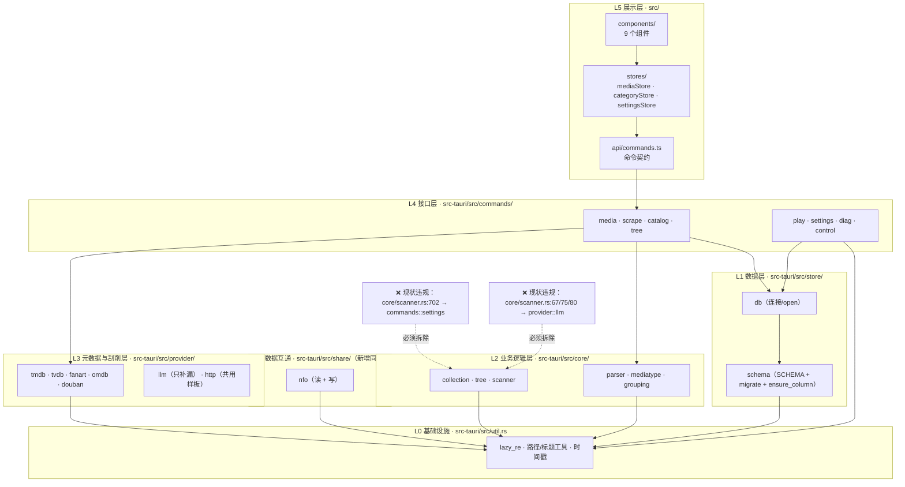
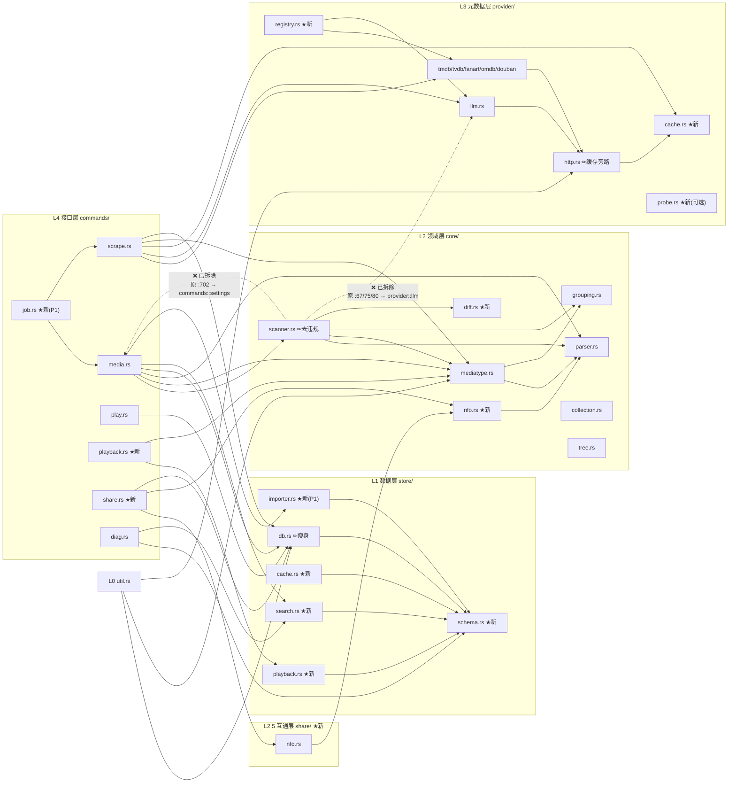

# media-manager 分层架构设计、改造路线与任务分工

| 项    | 内容                                                                                                                                                                           |
| ---- | ---------------------------------------------------------------------------------------------------------------------------------------------------------------------------- |
| 文档用途 | 在《开源影视/媒体资源管理项目调研与功能对比-2026-10-04》之上做**架构落位**：分层设计、改造路线、模块依赖、里程碑、任务分工。只做增量，不重写                                                                                               |
| 编写人  | 高见远（架构师）                                                                                                                                                                     |
| 上游输入 | `docs/开源影视管理项目调研与功能对比-2026-10-04.md`（许清楚）                                                                                                                                    |
| 代码基准 | 工作区 `G:\AI agent\media-manager` 当前工作树；行号为读取时实际位置，以「文件 + 函数名」为准                                                                                                               |
| 硬约束  | B1 主流程不变 / B2 本地优先单机 / B3 分层不反向依赖 / B4 判定集中可配置·Unknown 一等公民·结构证据优先 / B5 元数据 API 权威·LLM 只补漏 / B6 只增量迁移不重建库（当前 v5） / B7 upsert·group_key·locked·source 幂等语义 / B8 命令契约与前端结构不整体换 |

---

## 〇、先说结论（TL;DR）

| #  | 结论                                                                                                                                           |
| -- | -------------------------------------------------------------------------------------------------------------------------------------------- |
| C1 | **两个代码核验都比产品经理的推断更严重**：`SourceHint`（R1）在 production **100% 不生效**（唯一赋值点是单测）；`duration` **全库零写入**（R11 同样 100% 不生效），`resolution` 只有 LLM 猜一条来源   |
| C2 | 存在**一处既成的 B3 违规**：`core/scanner.rs:702-703` 调用 `crate::commands::settings::*`，`:67/75/80` 调用 `crate::provider::llm`。必须先收口，否则后续 P0 会把分层护栏彻底冲掉 |
| C3 | 四项决策：**不**做自动改名、**不**自研播放器/转码（先做观看状态+连播）、**不**启动服务化/多用户、插件化**只做到「注册表 + Trait + 配置开关」，不做动态加载**                                                |
| C4 | P0 落地顺序被代码事实改写：**先接 R1（成本极低、收益直接）**，再观看状态，再 FTS5；**ffprobe（R11 生效）必须最后做且默认不参与判定**                                                            |
| C5 | 分层目标形态：`util ← store ← core / provider / share ← commands ← src`，`commands` 是唯一可同时使用下三层的层                                                    |
| C6 | 主线工期约 **72 人日 / 2 人 ≈ 7.2 周**（含可选项 84 人日 ≈ 8.4 周），最大风险是「判定翻案」而非技术选型                                                                          |


---

## 一、两项代码核验（架构师亲验，含与产品经理判断的差异）

### 1.1 核验一：`SourceHint`（R1）到底接上没有

**结论：完全没接上。R1 在生产环境 100% 不生效。**

| 事实                                                   | 证据                                                                            |
| ---------------------------------------------------- | ----------------------------------------------------------------------------- |
| `SourceHint` 枚举已定义、带 `#[allow(dead_code)]`           | `src-tauri/src/core/mediatype.rs:134-139`                                     |
| `SourceHint::from_str` 已实现、同样带 `#[allow(dead_code)]` | `src-tauri/src/core/mediatype.rs:143-150`                                     |
| `Signals` 有 `source_hint: Option<SourceHint>` 字段     | `src-tauri/src/core/mediatype.rs:329`                                         |
| `classify()` 里 R1 是**第一条短路规则**，权重 `source_hint: 4`   | `src-tauri/src/core/mediatype.rs:604-619`、`Weights.source_hint` `:194`/`:211` |
| **全仓库唯一给 `sig.source_hint` 赋值的地方是单测**                | `src-tauri/src/core/tests/mediatype.rs:222`、`227`                             |
| 生产路径 ①：扫描入库喂信号，**未赋值**                               | `src-tauri/src/core/scanner.rs:131-140`（`classify_files`）                     |
| 生产路径 ②：存量重新识别喂信号，**未赋值**                             | `src-tauri/src/commands/media.rs:1329-1343`（`reclassify_library`）             |
| 生产路径 ③：单集反向修正喂信号，**未赋值**                             | `src-tauri/src/commands/media.rs:1394-1402`                                   |
| `Signals::from_parsed` 默认构造也不填它                      | `src-tauri/src/core/mediatype.rs:334-343`（`..Default::default()`）             |

**比产品经理判断更重的一层（差异点 D1）**：PM 写的是「命令层**尚未全部接上**」，实际是**一处都没接**；而且更关键的是——**目前根本没有地方产生这个信号**：

- `scrape.rs` 里的 `media_type` **是从库里读出来的、已经定好的类型**，不是数据源回传的类型：`read_pending()` 的 `media_type: r.get(1)?` 取的是 `media.type` 列（`src-tauri/src/commands/scrape.rs:217-231`），随后 `pick_tmdb_id(&p.tmdb, &pending.media_type, ...)`（`:910`）把它当**查询参数**送给 TMDb；
- TMDb 命中后的 `update_meta()`（`:238-243`）**不写 `type` 列**；
- 也就是说「TMDb 明明告诉我们这是剧集」这条权威信息，目前**既没有回流到 `core`，也没有回流到数据库**。

所以接线不是「加个参数传下去」，而是要**先造出产出点**。改动文件清单：

| # | 文件                                       | 改动                                                                                                                                                                                                                   |
| - | ---------------------------------------- | -------------------------------------------------------------------------------------------------------------------------------------------------------------------------------------------------------------------- |
| 1 | `src-tauri/src/core/mediatype.rs`        | 摘掉 `SourceHint` 与 `from_str` 上的 `#[allow(dead_code)]`（`:134`/`:143`）；补 `Signals::with_source_hint()` 或直接公开字段赋值（字段已是 `pub`，无需改）                                                                                       |
| 2 | `src-tauri/src/commands/scrape.rs`       | ① 新增 `resolve_source_hint(conn, id, &pending, &meta) -> Option<SourceHint>`：TMDb/TVDB/豆瓣命中后，把**数据源返回的类型**转成 `SourceHint`；② 在 `scrape_one` 命中分支（`:928` 之后）与 `apply_tmdb_match` 里调用；③ 命中且需要改判时走「gate + 重判 + 写回 `type`」 |
| 3 | `src-tauri/src/commands/media.rs`        | `reclassify_library`（`:1329` 附近）补 `sig.source_hint = hint_of(r)`——从 `r.tmdb_id` / `tvdb_id` 存在性推导（有 tvdb_id ⇒ 剧集；有 tmdb_id 但条目已有单集 ⇒ 不动）                                                                             |
| 4 | `src-tauri/src/core/tests/mediatype.rs`  | 现有 `source_hint_overrides_everything`（`:219`）保留；补「gate 生效」用例                                                                                                                                                         |
| 5 | `src-tauri/src/commands/tests/scrape.rs` | 补「TMDb 说是剧集 → `type` 被改判 / `locked=1` 不被改判」两条                                                                                                                                                                        |

**接线必须带的 gate（否则会毁数据）**：R1 在 `classify()` 里是**完全短路**（`mediatype.rs:604-619` 直接 return），一旦无门槛启用，重扫时会把「同目录几十集」的正确剧集判定翻成电影。因此 gate 放在 `commands`（策略层），**不动 `core` 的规则**：

```
允许 R1 生效的条件（全部满足）：
  ① locked = 0
  ② 该 media 行名下没有任何 episodes 行（有单集 ⇒ 已是剧集，不动）
  ③ 目标 kind 与当前 kind 不同
  ④ 当前 kind = Unknown，或（当前 kind ≠ Tv 且目标 = Tv）
     —— 即只允许「待确认 → 明确」与「电影 → 剧集」两个方向，禁止「剧集 → 电影」
  ⑤ 改判前把旧 kind 写进 scan_history.message / 或一张 audit 列，可追溯
```

> 说明：`④` 禁止「Tv → Movie」是本项目的历史伤疤（`mediatype.rs:5-15` 记载「大量剧集被误判成电影」），方向限制是刻意的不对称。

### 1.2 核验二：`resolution` / `duration` 有没有实测来源

**结论：没有任何实测来源。`duration` 全库零写入，R11 在生产环境 100% 不生效。**

| 事实                                                            | 证据                                                                                                                                               |        |                                  |
| ------------------------------------------------------------- | ------------------------------------------------------------------------------------------------------------------------------------------------ | ------ | -------------------------------- |
| `media.duration` / `episodes.duration` 列存在                    | `src-tauri/src/store/db.rs:46`、`:67`                                                                                                             |        |                                  |
| 扫描入库的 4 条 INSERT **都不含 `duration` 列**                         | `core/scanner.rs:450-456`（`insert_single`）、`:482-484`（`upsert_series`）、`:504-510`（`insert_episode`）、`:613-619`（`insert_episode_at`）→ 扫描后必然为 NULL |        |                                  |
| **全仓库没有任何语句写 `duration`**                                     | 检索 `duration =` / `SET duration` / `(duration` → **0 命中**（`store/db.rs` 的 schema 定义除外）                                                           |        |                                  |
| 重新识别读它 → `sig.duration_secs = r.duration`（`:1330`）→ 恒为 `None` | `commands/media.rs:1195`（SELECT）、`:1208`（读）、`:1330`（喂信号）                                                                                         |        |                                  |
| `classify()` 的 R11 整段被 `if let Some(sec)` 包住，永不进入             | `core/mediatype.rs:710-728`                                                                                                                      |        |                                  |
| 单测里 R11 是活的，因为**手填**                                          | `core/tests/mediatype.rs:111/123/127/138/448/476/481/516/554`                                                                                    |        |                                  |
| `ScanFile.resolution` 扫描时恒为 `None`，只有 LLM 增强层会填               | `core/scanner.rs:56`（字段注释即写明「正则解析器不产出」）、`:303`（`resolution: None`）、`:83`（`f.resolution = x.resolution`）                                          |        |                                  |
| `resolution` 唯一的落库点是 LLM 解析脏文件名后回填，且 `COALESCE` 首次写入即固化       | `commands/scrape.rs:778-784`                                                                                                                     |        |                                  |
| 无 ffprobe / ffmpeg / MediaInfo，也无任何探测管线                       | `src-tauri/Cargo.toml:50-73` 依赖仅 `tauri/serde/serde_json/opener/rusqlite(bundled)/walkdir/regex/ureq/dialog/indexmap`；全仓 \`ffprobe               | ffmpeg | MediaInfo`只命中`docs/`与`scripts/\` |
| 文件头只做**容器识别**（`ftyp` 盒子等），不 demux、不取时长                        | `core/parser.rs:20-56`、`VIDEO_EXTS` / `VideoContainer` / `AUDIO_ONLY_BRANDS`（`:72`）                                                              |        |                                  |
| 一条**过期注释**声称存在探测链路（不存在）                                       | `provider/douban.rs:281`：「目前 `media.duration` 走的是播放器/探测那条路」——但 `duration_minutes()`（`:284`）无任何写入调用方                                              |        |                                  |

**比产品经理判断更重的一层（差异点 D2）**：PM 写的是「`duration` 目前也**疑似**由外部数据填入」，实际是**没有任何一方写入**，`media.duration` 在整个生产链路中恒为 NULL。R11（单集 8~70 分钟 / 电影 ≥100 分钟）在 `mediatype.rs:32` 的规则表里赫然在列，但**从未参与过一次真实判定**。

**补齐应放在哪一层**（结论）：

| 能力                     | 落位                                                           | 理由                                                                           |
| ---------------------- | ------------------------------------------------------------ | ---------------------------------------------------------------------------- |
| ffprobe 进程调用与 JSON 解析  | **`provider/probe.rs`（新增）**                                  | 外部进程 / 外部世界 IO，与 `provider` 的语义（「怎么跟外部世界说话」）一致，参考 `provider/mod.rs:7-8` 的层定义 |
| 探测任务编排（哪些文件要探、并发、失败回退） | **`commands/media.rs` 或新增 `commands/probe.rs`**              | 需要 Connection + 事件进度，只有 `commands` 能同时使用下三层                                  |
| 技术参数字段的读写              | **`store/`（落到既有 `media` / `episodes` 表，或新增 `media_tech` 表）** | 持久化职责                                                                        |
| **不进 `core`**          | —                                                            | `core` 是纯领域规则层，不该依赖外部二进制                                                     |

**因此 P2-4（ffprobe）的顺序被改写为最末，且默认不参与判定**（见 §4.6「为什么 ffprobe 必须最后做」）。

### 1.3 附带发现：一处既成的 B3 违规（产品经理未提及，差异点 D3）

| 违规                           | 位置                                                                                                                      |
| ---------------------------- | ----------------------------------------------------------------------------------------------------------------------- |
| `core` → `commands`（反向依赖上层）  | `src-tauri/src/core/scanner.rs:702-703`：`crate::commands::settings::load_llm_config(conn)` / `load_hosts(conn)`         |
| `core` → `provider`（跨层横向依赖）  | `src-tauri/src/core/scanner.rs:67`（`cfg: &crate::provider::llm::LlmConfig`）、`:75`（`needs_enhancement`）、`:80`（`enhance`） |
| `core` → `store`（既成、可接受但应收敛） | `src-tauri/src/core/scanner.rs:3`：`use crate::store::db::now_epoch`                                                     |

`lib.rs:1-3` 明文承诺「`core` / `provider` / `store` 三者互不反向依赖，只有 `commands` 同时使用三者」——`core/scanner.rs` 已经把这三条破了两条。**这不是可以留着的债务**：P0-3（增量扫描）与 P0-5（NFO）都要往 `scanner` 里加东西，继续加会让「分层」只剩文档。收口方案见 §3.4。

---

## 二、改造建议

### 2.1 P0 五项：逐项落地设计

| ID                   | 机会                                                                                                                                                                                                                          | 改动范围（文件）                 | 优先级                                                                                        | 风险                                                                                                                               | 对现有流程的影响                                                                                                                         | 验证方式 |
| -------------------- | --------------------------------------------------------------------------------------------------------------------------------------------------------------------------------------------------------------------------- | ------------------------ | ------------------------------------------------------------------------------------------ | -------------------------------------------------------------------------------------------------------------------------------- | -------------------------------------------------------------------------------------------------------------------------------- | ---- |
| **P0-1** 元数据本地缓存     | 新 `store/cache.rs`、`provider/cache.rs`（trait）、`provider/http.rs`（旁路钩子）、`provider/mod.rs`（`Providers` 增字段）、`commands/scrape.rs`（注入实现）、`commands/settings.rs`（开关/清缓存）、`db.rs→schema.rs`（v6）                                   | **P0**（紧随 M0）            | 中：缓存陈旧（用户在 TMDb 改了数据本地不更新）；key 设计不当会串数据                                                    | **零**：miss 行为与当前完全一致，命中才省一次网络；**不改任何 provider 函数签名与优先级顺序**（B5 不受影响）                                                              | ① 单测：同 key 第二次不发起请求（用假 agent 计数）；② 手工：断网后重复刮削同一条目仍成功；③ 设置页「清空元数据缓存」后恢复联网行为                                                       |      |
| **P0-2** 观看状态 + 续播   | 新 `store/playback.rs`、新 `commands/playback.rs`、`commands/play.rs`（埋点 + 连播）、`lib.rs`（注册命令）、`src/api/commands.ts`、`src/stores/playbackStore.ts`（新）、`PosterCard.vue` / `MediaDetail.vue`（角标 / 继续播放 / 已看）、`db.rs→schema.rs`（v6） | **P0**（M1 主线）            | 中高：**没有秒级播放位置来源**（外置 PotPlayer 无法回传进度）→ 必须降级为集级进度 + 手动标记；另：连播依赖播放器对播放列表的支持                 | **零**：不介入 `resolve_player` 与播放器启动逻辑（`play.rs:26-35`/`:59-75`）；角标是纯增量 UI，不改导航结构（B8）                                               | ① 单测：标记已看 / 取消 / 集级推进 / `locked` 条目不被改写；② 手工：播放 3 集后重开应用，角标与「继续播放」仍指向第 4 集；③ 连播实测 PotPlayer 对临时 `.m3u8` 的支持（不支持则回退多参数）           |      |
| **P0-3** 增量 / 差异化扫描  | `core/scanner.rs`（指纹过滤入口）、新 `core/diff.rs`（指纹比对纯函数）、`commands/media.rs`（`full` 参数 + 指纹表）、`src/api/commands.ts` / `mediaStore.ts`（「重新扫描（全量）」入口）、`db.rs→schema.rs`（v6 补 `file_mtime`）                                         | **P0**（M3，排在 FTS5 之后）    | **高**：若误做成「只遍历变更文件」，会破坏 `build_folder_stats` 的目录共识统计（`mediatype.rs:876-919`），导致判定翻案（触碰 B4） | 默认行为变化：重扫变快、`skipped` 计数变大；**排序 / 分组 / 二次校正逻辑一行不改**                                                                              | ① 单测：未变更文件→`skipped+1` 且不写库；mtime 变→正常入库；② 单测：**目录共识统计仍基于全目录**（构造 20 集中只改 1 集的场景，判定必须不变）；③ 手工：全量兜底按钮能强制重写                        |      |
| **P0-4** FTS5 + 中文分词 | 新 `store/search.rs`（建表/同步/查询/回退）、`db.rs→schema.rs`（v6 迁移 + 触发器）、`commands/media.rs`（`LIST_WHERE` 增加 FTS 分支）、`commands/diag.rs`（能力探测暴露）、`Cargo.toml`（`rusqlite` 增 `functions` feature）、`src/api/commands.ts`（可选高级筛选参数，P1）    | **P0**（M2 主线）            | **高**：FTS5 是否编进 bundled SQLite 需在构建期确认；外部内容表 + 触发器写错会影响所有写入路径；SQLite 无法降级                  | 查询侧**先取 FTS 与 LIKE 的并集**（保证「新检索不会比旧检索更少」），验证无回归后切纯 FTS；FTS 不可用 → **原样回落现有 LIKE 分支**，用户无感                                         | ① 单测：中文 bigram 展开、大小写、数字年份、特殊字符 `%` `_` `\`；② 单测：**FTS 禁用时结果集与改动前逐条一致**；③ 迁移单测：v5 老库升级后表/触发器齐全且数据不丢；④ 手工：1500+ 条真实库上对比新旧结果集      |      |
| **P0-5** NFO 导入导出    | 新 `share/mod.rs` + `share/nfo.rs`（读写）、新 `core/nfo.rs`（NFO → 结构化候选，纯函数）、新 `commands/share.rs`（导入导出命令）、`commands/media.rs`（导入时按 Kodi 顺序补给判定）、`lib.rs`（注册）、`db.rs→schema.rs`（可选 audit 列）                                       | **P0**（M4，**导出先行、导入后补**） | 中：NFO 的 `<movie>` / `<tvshow>` 根元素若直接当结论会**违反 B4**（结构证据优先）；导入覆盖用户手工编辑                      | 导出：只读库 + 写新文件，**不动库**；导入：NFO 的 `title/year/tmdb_id` 可回填，**类型只作为 R1 的 `SourceHint` 候选并过 §1.1 的 gate**；不推翻「本地 NFO → 在线刮削」顺序约定之外的内容 | ① 单测：导出 XML 结构合法、中文转义、`<episodeguide>`；② 单测：**导入 `tvshow.nfo` 但目录只有 1 个文件时不改判**；③ 互通实测：导出的 NFO 能被 Kodi / Jellyfin 读（弱证据，标为外部验证项） |      |

> **P0-0（新增，本阶段插入）**：R1 `SourceHint` 接线 —— 见 §1.1。**成本约 4 人日，但必须排在 P0-4 之前**，因为「检索质量」的上限取决于「类型判对没有」。

### 2.2 P1 / P2 逐项：范围与建议

| ID                       | 机会                                         | 建议                                                                                                                            | 改动范围      | 风险 / 前置                                                      |
| ------------------------ | ------------------------------------------ | ----------------------------------------------------------------------------------------------------------------------------- | --------- | ------------------------------------------------------------ |
| **P1-1** 统一任务模型 Job      | **做**（M5）                                  | 新 `commands/job.rs`（trait + 统一 `job-progress` 事件）；**保留** `scan-progress`（`commands/media.rs:26`）与 `scrape-progress` 事件名并行（B8） | 低         | 先收拢事件与进度结构，**不动各自业务逻辑**                                      |
| **P1-2** 标签加厚 + 批量       | **做**（M5）                                  | `db.rs→schema.rs` 走 `ensure_column` 给 `tags` 加 `color` / `alias` / `parent_id`；`commands/catalog.rs`；前端复用既有 `selbar`          | 低         | 不删列、不改 `idx_tags_name` 唯一索引                                  |
| **P1-3** 剧集侧重复 / 副本检测    | **做**（M5）                                  | 扩 `core/collection.rs:20-35` 的**非破坏性**语义到 `tv`（只记 `duplicates` 视图，不删行）                                                        | 中         | 必须保持「不删数据」；与 B7 的 `group_key` 一致                             |
| **P1-4** 备份 / 导出 / 恢复    | **做**（M4，与 P0-5 同批）                        | `commands/share.rs`；用 SQLite `VACUUM INTO` 安全复制，**不改 `db::open` 路径**（`db.rs:162`）                                             | 低         | 需核验 bundled SQLite 版本 ≥ 3.27；否则回退文件拷贝（先停写）                   |
| **P1-5** 跨根目录同一剧集提示      | **做**（M5）                                  | 只做「疑似重复」提示，**系统不自动动手**                                                                                                        | 低         | 保持 README §八「跨根目录不合并」的有意为之                                   |
| **P1-6** 连播 / 下一集        | **做**（并入 M1，与 P0-2 同批）                     | `play.rs` 增加可选 `playlist` 参数；`playlist` 为空时**完整走原单文件路径**                                                                      | 中         | PotPlayer 对临时播放列表的支持需实测，不支持则回退多文件传参                          |
| **P2-1** 可选只读本地 HTTP API | **本期不做，仅预留**                               | 无新增文件；靠"`commands` 层保持纯函数 + `Connection` 形态"预留                                                                                | 高（触碰 B2）  | 若将来做：默认关闭 + 仅绑定 `127.0.0.1` + 无鉴权不启用                         |
| **P2-2** 多用户 / 权限        | **不做**                                     | —                                                                                                                             | 高         | 依赖 P2-1；P2-1 未落地前不引入                                         |
| **P2-3** provider 插件化    | **做一半：注册表 + Trait + 配置开关，不做动态加载**（M5 或 M6） | 新 `provider/registry.rs`；`provider/mod.rs:10-17` 的编译期固定列表 → `Vec<Box<dyn MetadataProvider>>`；`commands/settings.rs` 加开关       | 中         | Rust ABI 不稳定，动态加载需 `abi_stable` 或 WASM 沙箱，成本与收益不成比例；注册表是先决条件 |
| **P2-4** ffprobe 抽取技术参数  | **做，但排最后、默认不参与判定**（可选 M6）                  | 新 `provider/probe.rs`、`commands/probe.rs`；字段入库                                                                                | **高**     | 见 §4.6                                                       |
| **P2-5** 内置播放 / 转码       | **不做**                                     | —                                                                                                                             | 极高        | 见 §2.3 决策 ②                                                  |
| **P2-6** 字幕下载与管理         | **不做**                                     | —                                                                                                                             | 中         | 外围能力，依赖 P2-4                                                 |
| **P2-7** 自动改名 / 整理       | **不做**（本期）                                 | 仅**预留**：把 `file_path` 的写入收敛到单点（见 §2.3 决策 ①）                                                                                   | 极高（写用户磁盘） | 见 §2.3 决策 ①                                                  |
| **P2-8** 跨平台             | **不做**                                     | —                                                                                                                             | 高         | 与 B2 无冲突但工作量集中在打包链与播放桥接，非本期目标                                |


### 2.3 四个决策点：明确建议（不罗列）

#### 决策 ① 自动改名 / 整理：**本期不做（维持 P2，且不进入本轮里程碑）**

| 维度 | 判断 |
| --- | --- |
| 理由 | ①**唯一会写用户真实磁盘**的能力，误操作不可逆；②本项目的定位是「管理/检索/看」，不是「整理/清洗」（TMM 的定位），README §四 主流程里没有这一环（B1）；③没有任何用户诉求证据；④改名会让 `file_path` 变动，直接冲击 B7 的 `ON CONFLICT(file_path)` upsert 与 `group_key` 派生（目录名） |
| 但要做的事（预留） | 把散在 `core/scanner.rs:450/504/613`、`commands/media.rs:1412`、`commands/tree.rs:301` 等处的 `file_path` 写入收敛到一个 `store::paths::rename_file_path(conn, old, new)` 单点（**本期只收敛、不改行为**），并把「扫描根 → 相对路径 → 组键」的派生关系写进 `docs/`。将来要做改名时，dry-run 与撤销日志只需挂在这一个函数上 |
| 若将来要做的前提 | ①显式用户开关，默认关闭；②dry-run 预览为必经步骤；③只改文件名、默认不改目录结构；④完整撤销日志落库（复用 P1-4 的备份）；⑤走统一 Job（P1-1）且可中断 |
| 复核触发条件 | 用户明确表达「想批量整理文件名」诉求 → 重新评估 |

#### 决策 ② 内置播放器 / 转码：**不做。本期做「观看状态 + 集级续播 + 连播」**

| 维度 | 判断 |
| --- | --- |
| 为什么不做内置播放器 | ①要引入解码栈（FFmpeg / GStreamer / MPV），包体从「几十 MB」跳到「几百 MB」，且当前 README §一 是 Windows-only，打包链要重写；②转码需要硬件加速适配，是长期维护黑洞；③B1 的「播放」环节语义是「调用外部播放器」，换成内置会改变主流程；④与竞品差距最大 ≠ 用户最需要 |
| 为什么「观看状态」才是分水岭 | 调研 §4 第 12 项已判定：这是「管理自己的影视库」与「只是文件列表」的分界线，且**成本只有内置播放器的十分之一** |
| 但必须诚实处理「续播位置」 | 外置 PotPlayer 无法回传播放进度，因此**秒级续播在本期不可实现**。方案： |
| — 本期实现（P0-2a） | 集级进度（看到第几季第几集）+ 已看 / 未看标记 + 最近播放时间 + 播放次数；「继续播放」= 播放下一未看集（或当前集从头） |
| — 本期实现（P0-2b） | 连播：生成临时播放列表（`.m3u8`）交给播放器；回退方案为多文件传参 |
| — 自愿标记（P0-2c） | 详情页允许手动填写/修正「看到第几集」（极低成本，覆盖误判） |
| — 明确不做 | 秒级 `position_secs` 自动记录。**字段在 v6 表里预留**（`position_secs` / `duration_secs`），将来若内置播放器或读到播放器进度即可直接启用，无需再迁移 |
| — 可选实验（弱证据） | 探测 PotPlayer 的本地状态文件 / 注册表最近播放位置。**标为弱证据 + 需实测，不进主线**，不写进验收口径 |
| 复核触发条件 | 用户明确表达「想在本软件里直接看 / 想投屏」→ 再评估内置播放器 |

#### 决策 ③ 服务化 / 多用户：**本期不启动，仅预留**

| 维度 | 判断 |
| --- | --- |
| 结论 | 不启动。B2 是底线，且当前无多端诉求 |
| 预留方式（零成本） | 维持「`commands` 层函数 = 纯逻辑 + `Connection`，命令外壳只做并发与事件」——这一点**现在大体已成立**（`reclassify_library(&mut Connection, ...)`、`import_folder_into_sync(...)` 都是这个形态）。将来加 HTTP 只是再包一层 `interface/http`，不需要动 `core` |
| 明确不做 | 不提前引入 axum / actix / hyper，不提前建 `users` 表，不提前做鉴权 |
| 若将来要做 | 必须「设置里显式开关 + 默认关闭 + 仅绑定 127.0.0.1 + 无鉴权不启用 + 只读」，并在 `commands/diag.rs` 的 `runtime_info` 暴露监听状态 |

#### 决策 ④ 插件化：**本期做到「provider 注册表 + Trait 抽象 + 配置开关」为止，不做动态加载 / 第三方插件安装**

| 维度 | 判断 |
| --- | --- |
| 本期做（M5/M6，P2-3 的前半） | ①`provider/registry.rs`：`trait MetadataProvider { fn id(&self)->&str; fn search(...); fn detail(...); fn enabled(&self)->bool }`；②`provider/mod.rs:10-17` 的硬编码 `Providers` 改为**编译期注册 + 运行时按设置开关过滤**的 `Vec<Box<dyn MetadataProvider>>`；③内置五源（TMDb → TVDB → Fanart → OMDb → 豆瓣）的**优先级顺序写进注册表配置，不改语义**（B5）；④设置项可单独关闭某一源 |
| 本期不做 | 动态库加载（`libloading` / `abi_stable`，Rust ABI 不稳定）、WASM 沙箱、应用内在线安装插件、第三方签名与权限模型 |
| 理由 | 动态加载的工程量 ≈ 前面所有 P0 之和，而用户当前痛点（重复请求、检索慢、看不到看没看过、换机丢元数据）**一个都不需要插件**；注册表是插件化的先决条件，先把它做对 |
| 边界 | LLM **不进注册表**，保持「只补漏、失败即回退、绝不替代元数据 API」的独立定位（`provider/mod.rs:1-8`、`README.md` §四b） |
| 复核触发条件 | 出现「用户想接自建数据源」的明确诉求 → 再评估 WASM 插件（优先于原生动态库，因无 ABI 问题） |

---

## 三、分层架构设计

### 3.1 现状与目标形态总览



### 3.2 逐层设计

#### L1 数据层 —— `src-tauri/src/store/`

| 项 | 内容 |
| --- | --- |
| **现状** | `db.rs`（512 行）一肩挑：SCHEMA 常量 + `migrate`（v1→v5）+ `ensure_column` + `open` + 连接参数 + 8 张表的注释；`mod.rs` 仅导出。已具备：`PRAGMA journal_mode=WAL`、FK 级联、`busy_timeout(10s)`（`db.rs:162-169`）、`user_version` v5（`:175`）、5 个迁移单测 |
| **目标形态** | `store/db.rs`（瘦身为**连接入口**：`open` / `db_path` / `data_dir` / `tables`；`pub use schema::{migrate, ensure_column, SCHEMA, SCHEMA_VERSION}` 保证既有调用方与单测零改动）+ `store/schema.rs`（SCHEMA 常量 + `migrate` + `ensure_column` + v6 迁移步骤）+ `store/playback.rs` + `store/cache.rs` + `store/search.rs` + `store/importer.rs`（P1） |
| **职责边界** | 只负责「怎么存、怎么取、怎么迁」。**不含**任何领域规则（不判定类型、不解析文件名）、**不含**任何网络/外部进程调用 |
| **依赖方向** | 只依赖 `util` + `rusqlite`。**不得依赖 `core` / `provider` / `commands`**（现存的 `now_epoch` 由 `core/scanner.rs:3` 反向引用 → 计划把 `now_epoch` 下沉到 `util`，`store` re-export 保持兼容） |
| **映射到真实路径** | `src-tauri/src/store/db.rs`、`src-tauri/src/store/schema.rs`（新）、`src-tauri/src/store/{playback,cache,search,importer}.rs`（新） |
| **B6 守护** | 迁移一律 `CREATE TABLE IF NOT EXISTS` + `ensure_column`，**禁止** `DROP TABLE` / 重建库；`SCHEMA_VERSION` 5 → 6；迁移单测沿用既有 5 个用例的模式继续加（`db.rs:280-511`） |

#### L2 业务逻辑层 —— `src-tauri/src/core/`

| 项 | 内容 |
| --- | --- |
| **现状** | `parser.rs`（扩展名 + magic number 兜底）、`mediatype.rs`（R0–R12 多信号打分、可配置、`Unknown` 一等公民）、`grouping.rs`（剧集分组 + 二次校正 + 归一化标题匹配）、`collection.rs`（系列电影合集视图级去重）、`tree.rs`（`MAX_DEPTH=4`、环/深/自身/缺失校验）、`scanner.rs`（遍历 + 分类 + 分组 + 入库） |
| **目标形态** | 保持六个模块职责不变；`scanner.rs` **去掉对 `commands` 与 `provider` 的依赖**（LLM 增强层改为由调用方注入的闭包/enhancer 参数）；新增 `core/diff.rs`（增量指纹比对，纯函数）、`core/nfo.rs`（NFO → 结构化候选，纯函数，不碰文件系统） |
| **职责边界** | 领域规则与算法，**全部是纯函数**（输入数据 → 输出数据）。**不得**读配置表、**不得**发网络请求、**不得**调外部进程 |
| **依赖方向** | `util`（目标）。当前 `scanner.rs` 对 `store::db::now_epoch` 的引用改为 `util`；对 `Connection` 的使用（入库）**本期保留**（最小改动），P1 再下沉到 `store/importer.rs` |
| **映射到真实路径** | `src-tauri/src/core/{parser,mediatype,grouping,collection,tree,scanner}.rs`、`src-tauri/src/core/diff.rs`（新）、`src-tauri/src/core/nfo.rs`（新） |
| **B4 守护** | 判定规则**只写在 `core/mediatype.rs`**；`Unknown` 保留为 `MediaKind::default`（`mediatype.rs:93-94`）；结构证据（R0）继续优先于时长/体积（R11 受压制，`:710-728`）；新信号只能往 `Signals` 里加字段 + 往 `classify` 里加规则，**不得在别处另起一套判定** |

#### L3 元数据与刮削层 —— `src-tauri/src/provider/`

| 项 | 内容 |
| --- | --- |
| **现状** | `mod.rs` 定义固定层次（TMDb 权威 → TVDB 季集 → Fanart 美术 → OMDb 评分 → LLM 兜底）与 `Providers` 结构（编译期固定，`mod.rs:10-17`）；`http.rs` 是共用 HTTP 样板（`build_agent` / `get_json` / `post_json`，带自定义 hosts 解析与超时）；`llm.rs` 只解析脏文件名 |
| **目标形态** | 保持五源 + 层次不变；新增 `provider/registry.rs`（Trait + 注册表 + 运行时开关）、`provider/cache.rs`（`trait CacheBackend` + TTL 策略，**不直接碰 Connection**）、`provider/probe.rs`（ffprobe，可选 M6）；`http.rs` 增加可选的「缓存旁路」钩子（默认 `NoCache`） |
| **职责边界** | 「怎么跟外部世界说话」：HTTP 样板、鉴权错误文案、限流识别、超时、JSON 解析、外部进程调用。**不含**入库动作（缓存落库由 `commands` 注入的 `CacheBackend` 实现完成） |
| **依赖方向** | `util`；需要持久化时通过**注入的 trait** 完成，**不静态依赖 `store`** |
| **映射到真实路径** | `src-tauri/src/provider/{tmdb,tvdb,fanart,omdb,douban,llm,http}.rs`、`src-tauri/src/provider/{registry,cache,probe}.rs`（新） |
| **B5 守护** | 权威顺序不因注册表化而改变；LLM 永远在 TMDb/TVDB/豆瓣**之后**且只在识别失败时启用（`scrape.rs:910-920` 的调用形态保持不变）；失败即回退，绝不把 LLM 结果当元数据 API 的替代 |

#### L4 接口层 —— `src-tauri/src/commands/`

| 项 | 内容 |
| --- | --- |
| **现状** | `media.rs`（列表/详情/扫描/导入/重新识别/合集）、`scrape.rs`（刮削编排 + 进度）、`catalog.rs`（分类/标签）、`tree.rs`（层级 + 撤销栈）、`play.rs`（播放器桥接）、`settings.rs`、`diag.rs`、`control.rs`（`TaskControl` + `ScanControl`/`ScrapeControl` newtype）；`lib.rs:54-124` 静态注册 40+ 命令 |
| **目标形态** | 新增 `commands/playback.rs`（观看状态 / 续播 / 连播编排）、`commands/share.rs`（NFO 导入导出 + 备份恢复）、`commands/job.rs`（P1 统一任务模型）、`commands/probe.rs`（可选）；`play.rs` 增加可选 `playlist` 参数与播放埋点；`scrape.rs` 增加缓存注入与 R1 回写；`media.rs` 增加增量扫描开关与 R1 接线 |
| **职责边界** | 唯一允许**同时使用 `core` + `provider` + `store`** 的层。负责：Tauri 命令外壳、`spawn_blocking` / `std::thread::spawn` 并发、取消开关、事件推送、事务边界、策略 gate（如 R1 的 gate）、配置读取 |
| **依赖方向** | `core` + `provider` + `share` + `store` + `util` |
| **映射到真实路径** | `src-tauri/src/commands/{media,scrape,catalog,tree,play,settings,diag,control}.rs` + 新增 `{playback,share,job,probe}.rs`；`src-tauri/src/lib.rs` 追加命令注册 |
| **B8 守护** | 既有命令名、参数顺序、返回结构**一律不动**；新能力用**新命令**或**新增可选参数**接入（`play_media(path)` 保持可单参调用）；事件名 `scan-progress` / `scrape-progress` 保留 |

#### L5 展示层 —— `src/`

| 项 | 内容 |
| --- | --- |
| **现状** | `api/commands.ts`（契约 + 类型）、3 个 store（`mediaStore.ts` 710 行 / `categoryStore.ts` / `settingsStore.ts`）、9 个组件、`composables/useSwipeSelect.ts`、`utils/{dragSelect,tree}.ts`、`constants/mediaType.ts`、`types.ts`（`ViewKey` 刻意不用联合类型以避免硬编码枚举）；`vitest` 覆盖 8 个 spec |
| **目标形态** | 保持「api → stores → components」三段与 3+9 结构；新增 `stores/playbackStore.ts`；`PosterCard.vue` 加观看角标、`MediaDetail.vue` 加「继续播放 / 标记已看」；`mediaStore.ts` 的 `visibleItems()`（`mediaStore.ts:679-691`）在 FTS 上线后**降级为兜底**（后端已过滤时前端不再二次过滤） |
| **职责边界** | 只消费命令契约，不复制领域规则。**中文名映射等展示规则保留在前端**，但类型判定的真值只在 Rust |
| **依赖方向** | `src/api` → `src/stores` → `src/components`，单向 |
| **B8 守护** | 不整体换 store / 组件结构；新增组件不改动 `App.vue` 的视图切换与导航结构（`ViewKey` / `parseView` 语义不变） |

#### L2.5 数据互通层 —— `src-tauri/src/share/`（新增同级模块，符合 B3「新增同级模块」）

| 项 | 内容 |
| --- | --- |
| **为什么单独一层** | NFO 既是「本地数据源」（读）又是「持久化介质」（写），塞进 `provider` 会让 `provider` 承担写本地文件的职责，塞进 `core` 会破坏纯函数性。作为 `provider` 的同级模块最干净 |
| **职责** | `share/nfo.rs`：Kodi/Jellyfin/TMM 兼容的 NFO 读写（电影 `movie.nfo`、剧集 `tvshow.nfo` + `season.nfo` + 单集 `.nfo`）、中文转义、`<episodeguide>` |
| **依赖方向** | `util` + `core` 的纯数据类型（如 `ParsedName`）；**不依赖 `store` / `commands`**（落库与编排交给 `commands/share.rs`） |
| **B4 守护** | NFO 解析出的**类型**不作为结论，只作为 `SourceHint` 候选交给 `commands` 过 gate；NFO 的 `title` / `year` / `tmdb_id` / `season` / `episode` 属于**本地结构证据**，可补给 `Signals` 的既有字段（不新增判定通道） |

### 3.3 依赖方向总表

| 依赖方 ↓ / 被依赖方 → | util | store | core | provider | share | commands |
| --- | :-: | :-: | :-: | :-: | :-: | :-: |
| **util** | — | ✗ | ✗ | ✗ | ✗ | ✗ |
| **store** | ✅ | — | ✗ | ✗ | ✗ | ✗ |
| **core** | ✅ | ⚠️ 收敛中（仅 `now_epoch`/入库 IO） | — | ✗（须拆） | ✗ | ✗（**须拆，现违规**） |
| **provider** | ✅ | ✗（持久化靠注入） | ✗ | — | ✗ | ✗ |
| **share** | ✅ | ✗ | ✅（只读纯类型） | ✗ | — | ✗ |
| **commands** | ✅ | ✅ | ✅ | ✅ | ✅ | — |


> ✅ 允许　✗ 禁止　⚠️ 既成事实，本期收敛、P1 彻底下沉

### 3.4 如何不破坏 B3 / B8（本次改造的硬护栏）

| 风险点 | 护栏 |
| --- | --- |
| `core` 反向依赖 `commands`（**现已存在**：`scanner.rs:702-703`） | 把 `load_llm_config` / `load_hosts` 的调用**上移到 `commands/media.rs`**，通过 `Option<&LlmEnhancer>` 注入 `core::scanner`；`core` 不再出现 `crate::commands` 字样。加一条 CI 级检查（`verify.bat` 里加 `grep -rn "crate::commands" src-tauri/src/core/` 期望 0 命中，测试目录除外） |
| `core` 横向依赖 `provider`（**现已存在**：`scanner.rs:67/75/80`） | 同上，`apply_llm_enhancement` 改为接受一个 `enhance: &mut dyn FnMut(&mut ScanFile) -> bool`；`provider::llm` 的调用搬到 `commands` |
| `core` 依赖 `store::db::now_epoch` | `now_epoch` 下沉到 `util`，`store::db` 保留 `pub use` 兼容（`core/scanner.rs:3` 与所有 `crate::store::db::now_epoch` 调用方零改动） |
| `provider` 因缓存而依赖 `store` | 定义 `trait CacheBackend`（`provider/cache.rs`），实现放 `store/cache.rs`，由 `commands` 注入。**`provider` 侧只有 trait，没有 `rusqlite`** |
| `share` 因写文件而依赖 `store` | `share/nfo.rs` 只做「结构体 ↔ 字节流」；读哪个目录、写回哪张表由 `commands/share.rs` 决定 |
| 新增模块破坏分层 | 新模块只落在既有层内（`core/diff.rs`、`provider/cache.rs`、`store/playback.rs`…），或作为**新增同级模块**（`share/`）。**不新增介于两层之间的模糊层** |
| 改动 Tauri 命令契约（B8） | ①不改既有命令名与必填参数；②新能力走新命令（`mark_watched` / `export_nfo` …）或**追加可选参数**（`play_media(path, playlist?)`、`scan_library(roots?, full?)`）；③返回结构只加字段不改字段 |
| 前端结构被整体换掉（B8） | 保持 `api → stores → components` 三段与 3 store + 9 组件；新增 `playbackStore.ts` 与 2 个小组件；`App.vue` 的 `ViewKey` / `parseView` 语义不动 |

---

## 四、模块划分与依赖关系

### 4.1 模块清单（新增 vs 增强）

| ID | 模块 | 层 | 类型 | 主要文件 | 说明 |
| --- | --- | --- | --- | --- | --- |
| M-01 | 连接与入口 | store | 增强（瘦身） | `store/db.rs`、`store/mod.rs` | 保留 `open` / `db_path` / `data_dir` / `tables`，re-export `schema::*` 保证零破坏 |
| M-02 | Schema 与迁移 | store | 新增（拆出） | `store/schema.rs`（新） | SCHEMA 常量、`migrate`、`ensure_column`、v6 步骤、迁移单测 |
| M-03 | 播放状态仓储 | store | 新增 | `store/playback.rs`（新） | `playback_state` 表读写、集级推进、批量查询 |
| M-04 | 缓存仓储 | store | 新增 | `store/cache.rs`（新） | `provider_cache` 表读写 + `CacheBackend` 实现 + TTL 清理 |
| M-05 | 检索索引 | store | 新增 | `store/search.rs`（新） | FTS5 建表/同步/查询 + 中文 bigram + LIKE 回退 + 能力探测 |
| M-06 | 导入写入器 | store | 新增（P1） | `store/importer.rs`（新） | 承接 `scanner::import_reported` 的 SQL 部分，让 `core` 彻底纯函数化 |
| M-07 | 文件名解析 | core | 保持 | `core/parser.rs` | 扩展名清单 + magic number 兜底，一行不改 |
| M-08 | 类型判定 | core | 增强 | `core/mediatype.rs` | 摘 `allow(dead_code)`；规则与 `Unknown` 语义不变 |
| M-09 | 分组与二次校正 | core | 保持 | `core/grouping.rs` | 一行不改 |
| M-10 | 系列电影合集 | core | 保持 | `core/collection.rs` | P1-3 在此扩展到 tv |
| M-11 | 剧集层级树 | core | 保持 | `core/tree.rs` | 一行不改 |
| M-12 | 扫描编排 | core | 增强（去违规） | `core/scanner.rs` | 拆掉 `commands` / `provider` 依赖；加指纹过滤入口 |
| M-13 | 增量指纹 | core | 新增 | `core/diff.rs`（新） | `(path, size, mtime)` → `changed: bool` 纯函数 |
| M-14 | NFO 领域模型 | core | 新增 | `core/nfo.rs`（新） | NFO 字段 → 结构化候选（纯，不碰 IO） |
| M-15 | 元数据五源 | provider | 保持 | `provider/{tmdb,tvdb,fanart,omdb,douban}.rs` | 签名与优先级不动（B5） |
| M-16 | LLM 补漏 | provider | 保持 | `provider/llm.rs` | 定位不动 |
| M-17 | HTTP 样板 | provider | 增强 | `provider/http.rs` | 增可选缓存旁路，默认关闭 |
| M-18 | provider 注册表 | provider | 新增 | `provider/registry.rs`（新） | Trait + 编译期注册 + 运行时开关 |
| M-19 | 缓存策略 | provider | 新增 | `provider/cache.rs`（新） | `CacheBackend` trait + TTL 分级 |
| M-20 | 技术参数探测 | provider | 新增（可选） | `provider/probe.rs`（新） | ffprobe 调用与 JSON 解析 |
| M-21 | NFO 读写 | share | 新增 | `share/mod.rs`、`share/nfo.rs`（新） | Kodi/Jellyfin/TMM 兼容 |
| M-22 | 媒体命令 | commands | 增强 | `commands/media.rs` | 增量扫描开关、R1 接线、FTS 分支 |
| M-23 | 刮削命令 | commands | 增强 | `commands/scrape.rs` | 缓存注入、R1 回写 |
| M-24 | 播放命令 | commands | 增强 | `commands/play.rs` | 播放埋点 + 可选连播 |
| M-25 | 观看状态命令 | commands | 新增 | `commands/playback.rs`（新） | 标记已看/未看、集级进度、继续播放、连播编排 |
| M-26 | 互通命令 | commands | 新增 | `commands/share.rs`（新） | NFO 导入导出、备份恢复 |
| M-27 | 任务模型 | commands | 新增（P1） | `commands/job.rs`（新） | 统一进度事件（旧事件并行保留） |
| M-28 | 诊断 | commands | 增强 | `commands/diag.rs` | 暴露 schema 版本 / FTS5 可用性 / 索引健康 |
| M-29 | 前端契约 | src/api | 增强 | `src/api/commands.ts` | 增量命令与类型 |
| M-30 | 播放状态 store | src/stores | 新增 | `src/stores/playbackStore.ts`（新） | — |
| M-31 | 媒体 store | src/stores | 增强 | `src/stores/mediaStore.ts` | 全量重扫入口、`visibleItems` 降级为兜底 |
| M-32 | 组件 | src/components | 增强 | `PosterCard.vue`、`MediaDetail.vue` + 新增 `PlaybackBadge.vue`、`SearchFilterBar.vue`（P1） | 不改导航结构 |

### 4.2 依赖关系图（目标态）



### 4.3 数据库 v6 增量迁移清单（B6：只增不建、绝不重建）

| 新增对象 | 用途 | 迁移方式 |
| --- | --- | --- |
| `media.file_mtime` / `episodes.file_mtime` | P0-3 增量指纹 | `ensure_column(... "INTEGER")` |
| `playback_state` 表 + `idx_playback_target` | P0-2 | `CREATE TABLE IF NOT EXISTS` + `CREATE UNIQUE INDEX IF NOT EXISTS ... (media_id, IFNULL(episode_id,0))` |
| `provider_cache` 表 + `idx_provider_cache_exp` | P0-1 | `CREATE TABLE IF NOT EXISTS` |
| `media_fts`（FTS5 external content）+ 3 个触发器 | P0-4 | `CREATE VIRTUAL TABLE IF NOT EXISTS` + `CREATE TRIGGER IF NOT EXISTS`；**先探测 `pragma_compile_options` 是否含 `ENABLE_FTS5`，不含则整段跳过并回落 LIKE** |
| `tags.color` / `tags.alias` / `tags.parent_id` | P1-2 | `ensure_column` |
| `media.tech_json`（可选） | P2-4 实测参数 | `ensure_column`；**不参与判定** |

`SCHEMA_VERSION` 5 → 6；`migrate()` 结构保持不变，**既有 5 个迁移单测必须继续通过**，并至少新增：v5→v6 表齐全、v6 幂等、FTS5 缺失时迁移不失败、老数据行数不变。

---

## 五、开发里程碑（可验收）

| 里程碑 | 目标 | 交付内容 | 验收口径 | 顺序依赖 |
| --- | --- | --- | --- | --- |
| **M0 地基与合规收口** | 让后续所有改动落在干净的分层上，并把 v6 迁移机制做出来 | ①`store/schema.rs` 拆出 + `db.rs` re-export；②**拆除 `core→commands` / `core→provider` 反向依赖**；③`now_epoch` 下沉 `util`；④v6 迁移骨架（只做空迁移 + 版本位）；⑤`verify.bat` 加分层检查 | ①`cargo test` / `vitest` / `tsc --noEmit` 全绿；②`grep -rn "crate::commands\|crate::provider" src-tauri/src/core/`（非 tests）**0 命中**；③v5 老库升级到 v6 后 8 张表 + 数据行数不变；④既有 5 个迁移单测全过 | 无（所有后续的前置） |
| **M1 类型判定接线 + 观看状态** | 让 R1 真正生效；让「看没看过」进入产品 | ①R1 `SourceHint` 接线（含 gate）；②`playback_state` + `commands/playback.rs` + `playbackStore.ts` + 角标/继续播放；③连播（P1-6） | ①单测：`locked=1` 不被 R1 改判、已有单集的 tv 行不被改判、Unknown→Tv 生效；②手工：播放 3 集后重启应用，「继续播放」指向第 4 集；③连播在装/未装 PotPlayer 两种环境下都能起播 | M0 |
| **M2 检索升级（FTS5 + 中文）** | 中文能分词、大库检索不退化 | `store/search.rs` + v6 FTS5 迁移 + 触发器 + bigram + `LIST_WHERE` 分支 + 能力探测 + 前端高级筛选（P1） | ①FTS 禁用时结果集与改动前**逐条一致**；②FTS 启用时结果集 ⊇ LIKE 结果集（过渡期取并集）；③中文 2 字词可命中；`%` `_` `\` 不越权；④1500+ 条真实库上手工对比 | M0（**建议在 M1 之后**，因类型判对会提升检索质量） |
| **M3 元数据缓存 + 增量扫描** | 重复刮削不再重复请求；重扫不再全量写库 | `provider/cache.rs` + `store/cache.rs` + `http.rs` 旁路 + `core/diff.rs` + `media.rs` 指纹过滤 + `file_mtime` 列 + 全量兜底入口 | ①同 key 第二次不发起网络请求（假 agent 计数）；②断网后重复刮削同一条目仍成功；③未变更文件 `skipped+1` 且不写库；④**20 集中只改 1 集时，目录共识统计仍基于全目录、判定结果不变**；⑤全量兜底可强制重写；⑥B7：`locked` / `source='manual'` 条目不被增量路径改写 | M0、M2 |
| **M4 NFO 互通 + 备份恢复** | 元数据不再锁死在私有库 | `share/nfo.rs` + `core/nfo.rs` + `commands/share.rs` + 备份（VACUUM INTO）+ 设置页入口 | ①导出先做且**不改库**；②导入 `tvshow.nfo` 但目录只有 1 个文件时**不改判**（gate 生效）；③备份文件可独立打开且条数一致；④（外部验证，弱证据）导出物能被 Kodi / Jellyfin 读取 | M0、M1 |
| **M5 收尾：Job 统一 + 标签 + 去重 + 注册表** | 把 P1 收口，为 P2 留口 | `commands/job.rs` + `tags` 扩展 + `collection.rs` 扩 tv + `provider/registry.rs` + `store/importer.rs`（`core` 彻底纯函数） | ①新 `job-progress` 与旧 `scan-progress`/`scrape-progress` 并行可用，前端订阅切换无感；②关闭单个 provider 后其余层次顺序不变；③`core` 不再出现 `crate::store::db` 的入库调用（仅剩 `util`） | M1–M4 |
| **M6（可选）技术参数实测 + 插件化评估** | 让 `resolution` / `duration` 有真值 | `provider/probe.rs` + `commands/probe.rs` + 字段入库 | ①先**只填字段、不进判定**（R11 默认关闭）；②单独开关控制「是否让 R11 生效」；③抽样 100 个文件与播放器显示时长比对 | M5（**必须最后**） |

### 4.6 为什么 ffprobe（P2-4）必须最后做 —— 由核验二直接推导

`duration` 当前恒为 NULL ⇒ R11 **从未参与过任何一次真实判定**。一旦引入 ffprobe 并让 R11 生效：

- 所有 `duration ≥ 100 分钟` 且**无任何结构/命名剧集证据**的条目会凭空多出 `movie + 2`（`mediatype.rs:720-727`）。由于 `movie_threshold = 2`（`:252`），**这 2 分足以把一批 `Unknown` 直接翻成 `Movie`**——而这正是 `mediatype.rs:39-40` 明文要避免的「默默塞进电影」；
- 反过来，`duration ∈ [8,70] 分钟` 的条目会 `tv + 2`，逼近 `tv_threshold = 3`，可能把一批短片/预告翻成 `Tv`。

因此顺序被钉死：

1. **M6 之前**：`resolution` / `duration` 只做「字段填充」，**`Signals.duration_secs` 维持 `None`** —— 即 R11 继续不生效；
2. **M6 内部**：先做探测与入库，跑一次**离线对比**（对存量库用新字段跑一遍 `classify`，只统计「会翻案多少条」，**不写库**）；
3. 翻案比例与样本交给用户/产品裁决后，才决定是否在 `TypeConfig` 里打开 R11（默认 `UnknownPolicy::Unknown` 不变，`duration_episode` / `duration_movie` 权重默认置 0，或加一个 `r11_enabled: bool`）；
4. 即便打开，也必须配合 `locked` 保护 + 显式 `reclassify`，且**不自动重扫**。

> 这条是本次架构设计里最容易被忽略、但破坏力最大的一条顺序约束。

---


## 六、结构化任务分工

> **工作量假设**：团队规模 **2 人**（1 人主 Rust / 1 人主前端，可互相支援），人日 = 单人有效工作日（已按 0.7 有效工时折算）。若单人开发，日历周期 ≈ 人日数 / 1；若 2 人并行 ≈ 人日数 / 2。

```json
[
  {
    "id": "T-01",
    "name": "架构合规收口与数据层地基（M0）",
    "modules": ["M-01","M-02","M-28"],
    "responsibility": "拆出 store/schema.rs 并让 db.rs re-export；拆除 core/scanner.rs 对 commands 与 provider 的反向依赖（LLM 增强层改为注入）；now_epoch 下沉 util；搭 v6 迁移骨架；verify.bat 加分层检查；diag.rs 暴露 schema 版本与健康检查",
    "files": [
      "src-tauri/src/store/db.rs",
      "src-tauri/src/store/schema.rs（新）",
      "src-tauri/src/store/mod.rs",
      "src-tauri/src/core/scanner.rs",
      "src-tauri/src/commands/media.rs",
      "src-tauri/src/util.rs",
      "src-tauri/src/commands/diag.rs",
      "verify.bat"
    ],
    "skills": ["Rust","rusqlite","Tauri 2","重构（保持外部行为不变）"],
    "effort": { "rust": 5, "frontend": 0, "total_人日": 5, "人周_2人": 0.5 },
    "dependsOn": [],
    "blocks": ["T-02","T-03","T-04","T-05","T-06"],
    "acceptance": "cargo test / vitest / tsc --noEmit 全绿；core 非测试代码对 crate::commands 与 crate::provider 零引用；v5→v6 升级后 8 张表与数据行数不变"
  },
  {
    "id": "T-02",
    "name": "R1 SourceHint 接线与判定 gate（M1）",
    "modules": ["M-08","M-22","M-23"],
    "responsibility": "摘掉 SourceHint 的 allow(dead_code)；在 scrape 命中分支与 apply_tmdb_match 产出 SourceHint；reclassify_library 从 tmdb_id/tvdb_id 推导；实现五条 gate 并写回 type；补单测",
    "files": [
      "src-tauri/src/core/mediatype.rs",
      "src-tauri/src/commands/scrape.rs",
      "src-tauri/src/commands/media.rs",
      "src-tauri/src/core/tests/mediatype.rs",
      "src-tauri/src/commands/tests/scrape.rs",
      "src-tauri/src/commands/tests/media.rs"
    ],
    "skills": ["Rust","领域规则建模","单测"],
    "effort": { "rust": 4, "frontend": 0, "total_人日": 4, "人周_2人": 0.4 },
    "dependsOn": ["T-01"],
    "blocks": ["T-03","T-04"],
    "acceptance": "locked=1 与已有单集的 tv 行不被改判；Unknown→Tv 生效；Tv→Movie 被 gate 拒绝；改判可追溯"
  },
  {
    "id": "T-03",
    "name": "观看状态、续播与连播（M1 · P0-2 + P1-6）",
    "modules": ["M-03","M-24","M-25","M-29","M-30","M-32"],
    "responsibility": "playback_state 表与仓储；mark_watched / set_progress / resume_target / play_playlist 命令；play.rs 埋点与可选 playlist（单文件路径不变）；前端 playbackStore + PosterCard 角标 + MediaDetail 继续播放/标记已看；预留 position_secs 字段但不自动采集",
    "files": [
      "src-tauri/src/store/playback.rs（新）",
      "src-tauri/src/commands/playback.rs（新）",
      "src-tauri/src/commands/play.rs",
      "src-tauri/src/store/schema.rs",
      "src-tauri/src/lib.rs",
      "src/api/commands.ts",
      "src/stores/playbackStore.ts（新）",
      "src/components/PosterCard.vue",
      "src/components/MediaDetail.vue",
      "src/components/PlaybackBadge.vue（新）"
    ],
    "skills": ["Rust","SQLite","Vue 3","Pinia","Vitest","Windows 播放器行为实测"],
    "effort": { "rust": 6, "frontend": 6, "total_人日": 12, "人周_2人": 1.2 },
    "dependsOn": ["T-01","T-02"],
    "blocks": ["T-08"],
    "acceptance": "重启后观看状态与集级进度保持；已装/未装 PotPlayer 两种环境连播均可起；单文件 play_media(path) 行为与改动前完全一致"
  },
  {
    "id": "T-04",
    "name": "检索升级 FTS5 + 中文分词（M2 · P0-4）",
    "modules": ["M-05","M-02","M-22","M-28","M-29","M-31"],
    "responsibility": "store/search.rs（bigram 展开、建表、触发器、查询、能力探测、LIKE 回退）；v6 迁移 FTS5 + 触发器；LIST_WHERE 增 FTS 分支（过渡期取并集）；Cargo.toml 增 rusqlite functions feature；前端高级筛选（P1，可选）",
    "files": [
      "src-tauri/src/store/search.rs（新）",
      "src-tauri/src/store/schema.rs",
      "src-tauri/src/commands/media.rs",
      "src-tauri/src/commands/diag.rs",
      "src-tauri/Cargo.toml",
      "src/api/commands.ts",
      "src/stores/mediaStore.ts",
      "src/components/SearchFilterBar.vue（新，P1）"
    ],
    "skills": ["Rust","SQLite FTS5","中文分词","增量迁移","Vue 3"],
    "effort": { "rust": 9, "frontend": 5, "total_人日": 14, "人周_2人": 1.4 },
    "dependsOn": ["T-01"],
    "blocks": ["T-05","T-08"],
    "acceptance": "FTS 缺失时结果集与改动前逐条一致；FTS 启用时结果集 ⊇ LIKE；2 字中文词可命中；% _ \\ 不越权；v5 老库升级触发器齐全"
  },
  {
    "id": "T-05",
    "name": "元数据缓存与增量扫描（M3 · P0-1 + P0-3）",
    "modules": ["M-04","M-12","M-13","M-17","M-19","M-22","M-31"],
    "responsibility": "CacheBackend trait + store 实现 + http.rs 旁路 + TTL 分级 + 清缓存入口；core/diff.rs 指纹比对；media.rs 指纹过滤（遍历仍全量、只过滤写入）+ full 全量兜底；file_mtime 列",
    "files": [
      "src-tauri/src/provider/cache.rs（新）",
      "src-tauri/src/store/cache.rs（新）",
      "src-tauri/src/provider/http.rs",
      "src-tauri/src/provider/mod.rs",
      "src-tauri/src/commands/scrape.rs",
      "src-tauri/src/commands/settings.rs",
      "src-tauri/src/core/diff.rs（新）",
      "src-tauri/src/core/scanner.rs",
      "src-tauri/src/commands/media.rs",
      "src-tauri/src/store/schema.rs",
      "src/api/commands.ts",
      "src/stores/mediaStore.ts"
    ],
    "skills": ["Rust","SQLite","ureq","文件系统（mtime/size）","Vue 3"],
    "effort": { "rust": 10, "frontend": 2, "total_人日": 12, "人周_2人": 1.2 },
    "dependsOn": ["T-01","T-04"],
    "blocks": ["T-08"],
    "acceptance": "同 key 二次请求不发起网络调用；断网重复刮削仍成功；未变更文件 skipped+1 且零写入；20 集改 1 集时目录共识与判定不变；locked/manual 不被改写"
  },
  {
    "id": "T-06",
    "name": "NFO 互通与备份恢复（M4 · P0-5 + P1-4）",
    "modules": ["M-14","M-21","M-26","M-29","M-31"],
    "responsibility": "share/nfo.rs 读写（Kodi/Jellyfin/TMM 兼容、中文转义、单集 NFO）；core/nfo.rs 结构化候选；commands/share.rs 导出/导入/备份（VACUUM INTO）；导入时类型只作 SourceHint 候选并过 gate；设置页入口",
    "files": [
      "src-tauri/src/share/mod.rs（新）",
      "src-tauri/src/share/nfo.rs（新）",
      "src-tauri/src/core/nfo.rs（新）",
      "src-tauri/src/commands/share.rs（新）",
      "src-tauri/src/commands/media.rs",
      "src-tauri/src/lib.rs",
      "src/api/commands.ts",
      "src/components/SettingsPanel.vue",
      "src/stores/mediaStore.ts"
    ],
    "skills": ["Rust","XML","Kodi NFO 规范","SQLite VACUUM INTO","Vue 3"],
    "effort": { "rust": 7, "frontend": 3, "total_人日": 10, "人周_2人": 1.0 },
    "dependsOn": ["T-01","T-02"],
    "blocks": ["T-08"],
    "acceptance": "导出不改库；导入 tvshow.nfo 但目录单文件时不改判；备份文件可独立打开且条数一致；导出物能被 Kodi/Jellyfin 读（外部验证，弱证据）"
  },
  {
    "id": "T-07",
    "name": "provider 可插拔注册表（M5 · P2-3 前半）",
    "modules": ["M-18","M-15","M-16"],
    "responsibility": "MetadataProvider trait + 编译期注册表 + 设置项开关；Providers 结构改为 Vec<Box<dyn MetadataProvider>> 但**优先级语义完全不变**；LLM 不进注册表",
    "files": [
      "src-tauri/src/provider/registry.rs（新）",
      "src-tauri/src/provider/mod.rs",
      "src-tauri/src/provider/tmdb.rs",
      "src-tauri/src/provider/tvdb.rs",
      "src-tauri/src/provider/douban.rs",
      "src-tauri/src/commands/scrape.rs",
      "src-tauri/src/commands/settings.rs"
    ],
    "skills": ["Rust（trait 对象 / 泛型）","架构抽象"],
    "effort": { "rust": 6, "frontend": 0, "total_人日": 6, "人周_2人": 0.6 },
    "dependsOn": ["T-05"],
    "blocks": [],
    "acceptance": "关闭任一 provider 后其余层次与顺序不变；内置五源行为与改动前一致；LLM 仍只在识别失败时启用"
  },
  {
    "id": "T-08",
    "name": "统一任务模型、标签加厚、剧集去重与 core 纯函数化（M5 收尾）",
    "modules": ["M-06","M-10","M-27","M-28","M-31","M-32"],
    "responsibility": "commands/job.rs 统一进度事件（旧事件并行保留）；tags 加 color/alias/parent_id + 批量打标；collection.rs 去重扩到 tv（非破坏性、只记不删）；疑似重复提示；store/importer.rs 承接入库 SQL 让 core 彻底纯函数",
    "files": [
      "src-tauri/src/commands/job.rs（新）",
      "src-tauri/src/commands/media.rs",
      "src-tauri/src/commands/scrape.rs",
      "src-tauri/src/commands/catalog.rs",
      "src-tauri/src/core/collection.rs",
      "src-tauri/src/store/importer.rs（新）",
      "src-tauri/src/core/scanner.rs",
      "src-tauri/src/store/schema.rs",
      "src/stores/mediaStore.ts",
      "src/components/MediaDetail.vue",
      "src/App.vue（仅事件订阅切换）"
    ],
    "skills": ["Rust","Vue 3","Pinia","Vitest"],
    "effort": { "rust": 7, "frontend": 3, "total_人日": 10, "人周_2人": 1.0 },
    "dependsOn": ["T-03","T-04","T-05","T-06"],
    "blocks": ["T-09"],
    "acceptance": "新 job-progress 与旧 scan/scrape-progress 并行可用且前端无感；去重不删任何数据行；core 非测试代码不再出现入库 SQL"
  },
  {
    "id": "T-09",
    "name": "技术参数实测与 R11 生效评估（M6 · 可选，P2-4）",
    "modules": ["M-20","M-22","M-28"],
    "responsibility": "provider/probe.rs 调 ffprobe 解析 JSON；commands/probe.rs 编排与节流；字段入库（先只填字段）；离线跑一遍 classify 统计「会翻案多少条」不写库；由裁决决定是否开关 R11",
    "files": [
      "src-tauri/src/provider/probe.rs（新）",
      "src-tauri/src/commands/probe.rs（新）",
      "src-tauri/src/commands/media.rs",
      "src-tauri/src/core/mediatype.rs",
      "src-tauri/src/store/schema.rs",
      "src-tauri/Cargo.toml",
      "src-tauri/tauri.conf.json（二进制随包）"
    ],
    "skills": ["Rust","ffprobe / FFmpeg 部署","Windows 打包","数据分析"],
    "effort": { "rust": 8, "frontend": 0, "total_人日": 8, "人周_2人": 0.8 },
    "dependsOn": ["T-08"],
    "blocks": [],
    "acceptance": "默认只填字段、R11 不生效；离线翻案报告产出；抽样 100 个文件与播放器时长比对通过；R11 开关未显式打开时判定结果与 M5 完全一致"
  }
]
```

### 6.1 工期汇总

| 口径 | 人日 | 2 人并行日历周 |
| --- | --- | --- |
| 主线（T-01 … T-06 + T-08） | **72** | ≈ **7.2 周** |
| 主线 + T-07（provider 注册表） | 78 | ≈ 7.8 周 |
| 全部（含可选 T-09 ffprobe） | **84** | ≈ **8.4 周** |

并行建议：T-03（前端重）与 T-04（Rust 重）可由两人分别主领；T-05 与 T-06 在 T-01/T-02 完成后可并行。

---

## 七、共享知识（工程约定，跨任务通用）

| # | 约定 |
| --- | --- |
| 1 | 所有 Tauri 命令返回 `Result<T, String>`，错误文案直接给用户看（中文），沿用现有风格 |
| 2 | 新增数据库对象一律 `CREATE TABLE/INDEX/TRIGGER IF NOT EXISTS` 或 `ensure_column`；**禁止** `DROP` / 重建库；`SCHEMA_VERSION` 每次结构变更 +1 |
| 3 | 所有时间戳为 Unix 秒（`i64`），来源于 `util::now_epoch()` |
| 4 | 新能力优先「新增命令」或「追加可选参数」，**不改既有命令名与必填参数顺序** |
| 5 | `core` 内不得出现 `crate::commands` / `crate::provider`（`verify.bat` 加检查）；`provider` 不得静态依赖 `store`（持久化走注入 trait） |
| 6 | 类型判定只允许在 `core/mediatype.rs` 内加规则；新信号先加进 `Signals` 再加进 `classify`，并补 `Verdict.reasons` |
| 7 | 任何可能改变既有条目 `type` / `group_key` 的写入，必须尊重 `locked = 1` 与 `source = 'manual'` |
| 8 | 缓存 key 必须含 provider 名；失败响应**不进正缓存**；所有缓存行带 `expires_at` |
| 9 | 检索改动必须能「一键回落」：FTS5 不可用 / 查询过短 / 结果为空 → 走原 `LIKE ... ESCAPE '\'` 分支 |
| 10 | 前端 `src/types.ts` 的 `ViewKey` 继续用 `string`（分类来自数据库，禁止硬编码枚举） |
| 11 | 每个新增 Rust 模块必须带 `#[cfg(test)]` 单测；`cargo test` / `vitest` / `tsc --noEmit` 三件套由 `verify.bat` 统一卡口 |
| 12 | 涉及外部事实（PotPlayer 播放列表支持、Kodi 读 NFO、bundled SQLite 是否含 FTS5）必须先实测，实测前在文档中标注为「弱证据」 |

---

## 八、最大架构风险（Top 5）

| 排序 | 风险 | 为什么是它 | 缓解 |
| --- | --- | --- | --- |
| **R-1（最高）** | **判定翻案** | 本次有 4 处改动会改变 `classify` 的输入（R1 接线、R11 若生效、增量扫描若误做成增量遍历、NFO 导入的类型字段）。历史伤疤就是「大量剧集被误判成电影」（`mediatype.rs:5-15`），一旦重扫把用户已确认的分类推翻，是**不可逆的用户信任损失** | ①R1 走五条 gate 且禁止 `Tv → Movie`；②增量扫描**只过滤写入、不改遍历与统计**；③R11 默认不生效；④所有改判尊重 `locked`；⑤改判可追溯 |
| **R-2** | **v6 迁移不可逆** | FTS5 外部内容表 + 触发器一旦写错会影响所有写入路径；SQLite 无法降级；用户库里有真实数据（B6） | ①迁移在事务内；②先 `VACUUM INTO` 备份；③能力探测失败整段跳过；④至少 4 条新迁移单测；⑤启动时 `diag` 暴露版本与健康 |
| **R-3** | **既存 B3 违规未收口就往上加功能** | `core/scanner.rs:702` 已经反向依赖 `commands`，P0-3 / P0-5 还要往 `scanner` 加东西，继续加会让分层只剩文档、后续任何模块都可能互相调用 | M0 第一优先级拆除；`verify.bat` 加静态检查把违规钉死 |
| **R-4** | **FTS5 与中文分词的落地不确定性** | bundled SQLite 是否编译了 FTS5 需在构建期确认；`rusqlite` 需加 `functions` feature 才能注册自定义标量函数；bigram 对 1 字词无效 | ①启动时 `pragma_compile_options` 探测；②双路径（触发器 + Rust 标量函数 / 应用层维护索引）；③查询侧与 LIKE 取并集过渡；④1 字词回落 LIKE |
| **R-5** | **观看状态的「续播」预期落差** | 用户会按 Jellyfin 的「秒级续播」预期来理解，但外置播放器无法回传进度 | ①文档与 UI 明确口径为「集级续播」；②字段预留 `position_secs`；③不把秒级续播写进本期验收口径 |

---

## 九、仍需裁决 / 假设

| # | 事项 | 假设 / 建议 |
| --- | --- | --- |
| 1 | bundled SQLite 是否含 FTS5 | **假设含**；若实测不含，则改用 `rusqlite` 的 `bundled` + 显式编译开关，或降级为「应用层维护的普通索引表 + bigram 列 + LIKE 优化」。**必须在 M2 开工第一天实测** |
| 2 | `rusqlite::create_scalar_function` 需 `functions` feature | 假设可直接加；若不想加 feature，改用应用层维护 FTS 行（写路径显式调用 `search::index_media`） |
| 3 | PotPlayer 是否支持打开临时 `.m3u8` 播放列表 | **弱证据、需实测**；不支持则回退「多文件传参」，再不行则降级为「播完一集后由用户点『下一集』」 |
| 4 | `VACUUM INTO` 需 SQLite ≥ 3.27 | bundled 版本远高于此，**假设可用**；不可用则回退「暂停写入 + 文件拷贝」 |
| 5 | 用户是否需要「自动改名 / 整理」 | 本期假设**不需要**（见决策 ①）。若用户确认需要，需重新评估一个独立里程碑 |
| 6 | 用户是否需要多端 / 内置播放 | 本期假设**不需要**（见决策 ②③） |
| 7 | `provider/douban.rs:281` 的过期注释 | 建议在 M0 顺手修正为「`media.duration` 当前无写入方（见架构文档 §1.2）」，避免后人被误导 |
| 8 | 单测规模 | 现有 `cargo test` 数百例 / `vitest` 上百例。本次每个里程碑要求新增单测，**但不要求覆盖率达到某个硬指标**（以既有风格为准） |
