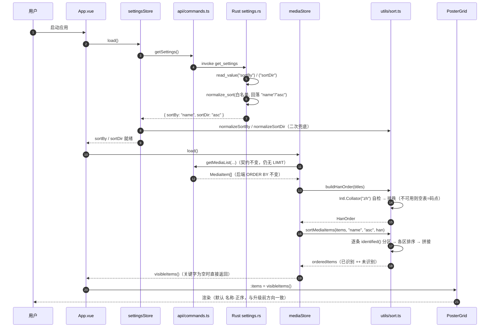
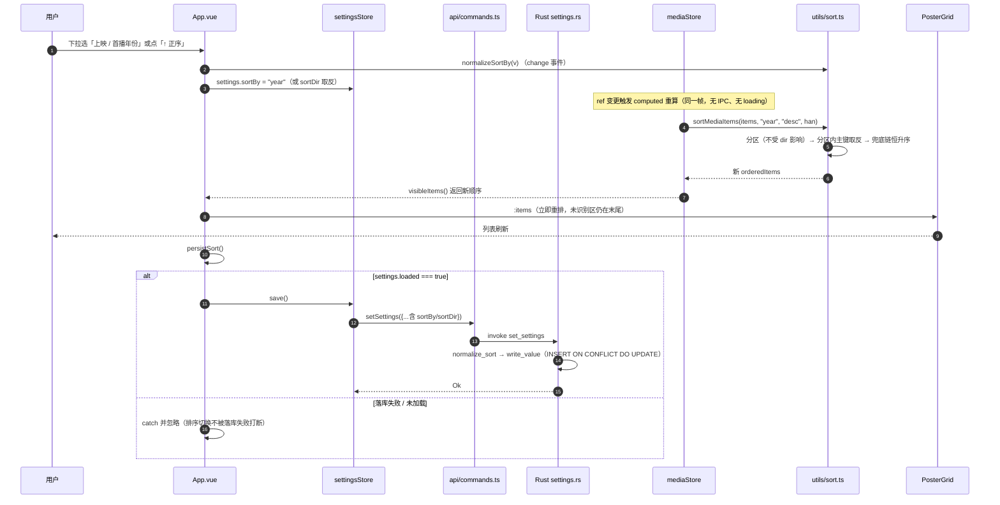

# 列表排序规则 · 增量系统设计 + 任务分解

| 项 | 内容 |
|---|---|
| 文档类型 | **增量设计**（架构决断 + 任务分解；只描述变更部分） |
| 日期 | 2026-10-07 |
| 架构师 | 高见远（Gao） |
| 上游契约 | `docs/排序规则-增量PRD-2026-10-07.md`（语义定义以此 PRD 为准，本文只决断**落地方式**） |
| 项目 | `media-manager`（Tauri 2 + Vue 3 + Pinia + Vite 5 + TS strict / Rust + SQLite，Windows 本地单机） |
| 变更范围 | 前端 `src/`（主）+ 后端 `src-tauri/commands/settings.rs`（辅）；**不动主流程、不动视频文件、不加列、不加依赖** |

---

## 0. 三个决断（TL;DR）

| # | 问题 | PM 默认 | **架构决断** | 一句话理由 |
|---|---|---|---|---|
| D1 | 排序落前端还是后端 | 前端 | ✅ **确认前端**（`src/utils/sort.ts` 纯函数 + `mediaStore` 内 `computed`） | 无分页 + 要「立即重排」+ 不动 `get_media_list` 契约；后端路径要在 Rust 里再实现一份拼音，等于制造第二真源 |
| D2 | 拼音 A 档 / B 档 / C 档 | A 档（100KB 静态表） | ❌ **A、B 都否决** → **新增 D 档：ICU/CLDR 内置 `Intl.Collator("zh")`**（实测真·全拼序，零数据表），ICU 不可用时降级码点（= C 档） | 本机无离线拼音数据源（无 pypinyin、无网络包），A/B 都要手写/生成 8000 字表；而 ICU 已内置且**实测正确**，零依赖零数据 |
| D3 | J3「缺年份」在「按名称排序」时是否也沉底 | 是 | ✅ **确认「是」**（分区与排序键解耦） | 符合用户原话「缺少元数据」；分区不随排序键跳变是可测不变量；且改为「仅时间键生效」只需改 `identified()` 一行 |

**额外决断（PRD 未覆盖，本文补齐）**

| # | 决断 | 理由 |
|---|---|---|
| D4 | **倒序只取反「主键」，兜底链（名称键 → year → id）恒升序** | 兜底链的作用是「消除歧义」，不是「参与用户感知的方向」；恒升序让「同年同名的几条」在正序/倒序下相对顺序一致，用户可预测 |
| D5 | **倒序禁止用 `Array.reverse()`** | `reverse` 会把主键相等的一批也翻转，破坏兜底链语义；必须 `cmp(b, a)` |
| D6 | **未识别分区内，时间键缺失者排该分区末尾（NULL 视作最大），其内部按名称键** | 填补 PRD 4.3 的空档；与 PRD 4.1 二级「NULL 视作最大」保持一致，且与「缺年份按名称键排」不冲突 |
| D7 | **先排序、后按关键字过滤**（`orderedItems` computed → `visibleItems()` 过滤） | 排序是全序，子集排序与全集排序结果一致；这样敲关键字只做 O(n) 过滤，不会每次按键重排 |
| D8 | **不新增 `src/utils/pinyin-data.ts`** | D 档不需要静态表（见 §1.3） |

---

## 1. 实现方案

### 1.1 D1：排序落在前端（确认 PM 默认）

| 维度 | 前端排序（选） | 后端排序（`core/sort.rs`） |
|---|---|---|
| 「立即重排」 | 改一个 `ref` → `computed` 重算 → 同帧渲染，**零 IPC** | 要 IPC + 重查 + `loading` 闪一下，不满足「立即」 |
| 数据可得性 | `get_media_list` **无 LIMIT/OFFSET**，全量已在内存 | 同样全量，无收益 |
| 命令契约 | 不动 `get_media_list`（B8） | 要加 `sort_by`/`sort_dir` 可选参数（向后兼容但改契约） |
| 拼音实现 | 复用 JS 运行时 ICU（见 §1.3） | **要在 Rust 里再实现一份拼音**，要么搬 8000 字表进 Rust，要么调 Windows API —— 双真源，必错 |
| 可测性 | 纯函数 + vitest，毫秒级 | `cargo test` 更重 |
| 其它视图 | 只影响 `PosterGrid`，`SeriesTree`/`CollectionPanel` 天然不受影响 | 容易误伤共用的 `get_media_list` 调用方 |

**结论**：前端。后端只承担**持久化两个 KV**（走既有 `settings` 通路），不承担排序计算。
P1-3（后端统一排序路径）**降级为「不建议做」**：在确认前端排序后它只会带来双真源，除非未来出现「导出 / 命令行 / 虚拟滚动分页」的真实需求。

### 1.2 排序在前端的具体落点

`mediaStore` 内新增两个 `computed`，`visibleItems()` 改为返回过滤后的结果：

```ts
// ① 只依赖 items（不含 keyword）：全库汉字 → 拼音秩，全量排序一次
const hanOrder   = computed(() => buildHanOrder(items.value.map(rawTitleOf)));
// ② 依赖 items + sortBy + sortDir：分区 → 排序（纯整数比较，毫秒级）
const orderedItems = computed(() =>
  sortMediaItems(items.value, settings.sortBy, settings.sortDir, hanOrder.value));
// ③ 只依赖 keyword：O(n) 过滤，不重排
function visibleItems(): MediaItem[] { /* 在 orderedItems.value 上按关键字过滤 */ }
```

**为什么必须这么做**：`visibleItems()` 在 `App.vue` 里被调用 4 次（`:items`、全选计数、按钮 disabled、`allPicked`），store 内部（`toggleSelectAll` / `invertSelection` / `pruneSelection`）还要调 3 次。若把排序塞进 `visibleItems()` 函数体，一次渲染会跑 7 遍全量排序 —— 必须靠 `computed` 缓存。

### 1.3 D2：拼音 —— 否决 A / B，采用 D 档（ICU 内置）

#### 否决 A / B 的理由（硬事实）

1. **本机无离线拼音数据源**（已核实）：`python -c "import pypinyin"` 失败；`node_modules` 无任何 pinyin 包；项目 C11 明令**不得引入第三方依赖**。
2. 因此 A 档 / B 档的 6763 字表**只能靠联网抓公开数据再生成**（如 `overtrue/pinyin-data`）。这条路有三个问题：
   - 引入了一条「构建期联网」的隐性依赖，与 B2（本地优先）/C11 的精神冲突；
   - 数据源许可需额外确认（kTGHZ2013 数据为 CC-BY-SA）；
   - 生成物是 30–100KB 的**手写常量**，无法人工核对，一旦错字无人能发现，且长期是维护负担。
3. B 档相对 A 档只省体积，不省「生成」这道工序 —— **工序成本一样，收益却更差（同声母内非严格拼音序）**，所以 B 档不值得单列。

#### D 档：ICU / CLDR 内置 zh 拼音排序

**`Intl.Collator("zh")` 是 ECMAScript 标准库（`Intl`）**，随 Node / Chromium 的 ICU 一起分发，**不是第三方依赖、不是数据表、不需要联网**。CLDR 中 `zh` 的默认 collation 就是 **pinyin**（`zh-Hant` 才是 stroke，注意别用）。

**实测证据**（本项目 Node v22.22.2，full-ICU，`small-icu: false`；脚本见 §9 复核命令）：

```
单字排序: 阿 八 爸 白 陈 出 李 刘 妈 马 骂 王 卧 无 叶 英 欲 张 长 中 重 宙
         a < ba < ba < bai < chen < chu < li < liu < ma < ma < ma < wang < wo < wu < ye < ying < yu < zhang < zhang < zhong < zhong < zhou   ✅ 严格全拼序
片名排序: 阿甘正传 | 白日梦想家 | 拆弹专家 | 盗梦空间 | 恶棍天使 | 飞驰人生 | 功夫 |
         红海行动 | 集结号 | 空中监狱 | 乐高大电影 | 美人鱼 | 那些年 | 卧虎藏龙 | 叶问 | 战狼      ✅ a bai chai dao e fei gong hong ji kong le mei na wo ye zhan
```

结论：**D 档 = A 档的排序质量，B 档的实现成本，且零数据文件**。

#### D 档的两个已知边界（必须写进注释与验收说明）

| 边界 | 说明 | 处理 |
|---|---|---|
| 声调参与排序 | CLDR zh collation 对声调有序（实测 `妈 < 马 < 骂`）。PRD 4.1 写的是「无声调」 | **接受**：ICU 的声调序（阴平→阳平→上声→去声）稳定可解释；它只是让原本要靠 `id` 兜底的同音字获得确定顺序，反而更贴合 PRD 4.0「全序」要求。PRD「无声调」的诉求是「不要出现用户无法理解的顺序」，声调序满足该诉求 |
| 多音字 | CLDR 已按常用读音取舍（实测 `长` 取 `zhang`，而非 `cháng`） | 与任何静态表（同样取常用读音）等价，可接受。用户自定义覆盖仍放 P1-4 |
| 运行环境差异 | Node（vitest）与 WebView2（Chromium）都用完整 ICU，`zh` collation 行为一致 | 加**运行时自检 + 降级**（见下），最坏情况 = 码点序 = 升级前行为，**不会崩也不会乱序** |

#### 自检与降级

```ts
/** `zh` 拼音排序在本运行时是否可用（模块加载时判定一次）。 */
export function hanCollatorUsable(): boolean {
  return ZH.compare("阿", "白") < 0 && ZH.compare("白", "宙") < 0 && ZH.compare("卧", "无") < 0;
}
```
- 可用 → `buildHanOrder()` 用 `ZH.compare` 给汉字排秩；
- 不可用 → `buildHanOrder()` 返回**空表**，汉字一律回落 Unicode 码点（= C 档 = SQLite `COLLATE BINARY` 的汉字行为 = 升级前行为），并在 `console.warn` 一次性提示。

> 因为拼音秩是**用当前列表里实际出现的汉字**构建的，所以「表外汉字」这个 A/B 档的概念在 D 档下**不存在**（覆盖率恒为 100%）。

#### ⚠ D 档三条实现红线（工程师必读，违反即验收不通过）

| # | 红线 | 实测证据 | 违反后果 |
|---|---|---|---|
| **R1** | **禁止 `collator.compare(整串标题)`**。ICU 只用来给**单个汉字**排秩；类别序、数字、拉丁、标点一律由「权重流 + 纯整数比较」自己控制 | `Intl.Collator("zh").compare("Avatar","阿甘正传") = 1`（汉字排在拉丁**之前**）—— CLDR zh collation 做了 **script reordering**，Han 优先于 Latin | P0-2 样本会变成 `2012 → 阿甘正传 → 宙斯之子 → Avatar`，与 PRD 要求的 `2012 → Avatar → 阿甘正传 → 宙斯之子` **相反**，验收不通过 |
| **R2** | **归一化必须自己做**（NFKC → NFD 去组合记号 → toLowerCase → 剥离空白/标点），不能指望 ICU | `compare("阿 甘","阿甘") = -1`（ICU **不忽略**空格）；`compare("avatar","Avatar") = -1`、`compare("éclair","eclair") = -1`（tertiary 差异仍在） | 大小写/重音/空格参与比较，出现用户无法理解的顺序 |
| **R3** | **locale 写死 `"zh"`**，不传 `undefined`、不用系统默认 | 实测 `zh` / `zh-Hans` / `zh-CN` / `zh-Hans-CN` 排序结果**完全一致**；`zh-Hant` 结果**完全不同**（那是笔画序） | 误用 `zh-Hant` / `undefined` 会让汉字整体乱序 |

**补充（PM 复核时提出，已确认）**：buildHanOrder 排秩时若两个**不同**汉字 `compare === 0`，必须**合并为同一秩**（让它们落到下一个字符 / year / id 兜底），而不是给两个任意秩。
> 实测 10 组同音字（阿/吖、衣/一、做/作、在/再、是/事、李/里、中/钟、十/石、妈/蟆、亿/意）**全部返回非零**，ICU 对任意两个不同汉字都能定序（内部回落到笔画/码点）。此规则属**防御性保留**，实现时照写即可。

### 1.4 性能预算

| 环节 | 触发时机 | 成本 |
|---|---|---|
| `buildHanOrder` | 仅 `items` 变化（加载 / 扫描完 / 刮削完 / 删除后） | 扫全量标题取唯一汉字（几千个）→ `sort` 约 `n log n` 次 ICU 比较 ≈ 10–30ms（1 万条库） |
| `sortMediaItems` | `items` / `sortBy` / `sortDir` 变化 | 权重流是扁平 `number[]`，纯整数比较，< 5ms |
| 关键字过滤 | 每次按键 | O(n) 字符串包含，无排序 |

---

## 2. 文件清单

| 文件 | 类型 | 改什么 |
|---|---|---|
| `src/utils/sort.ts` | **新增** | 排序内核：枚举、归一化、权重流、`HanOrder`、`identified`、比较器、`sortMediaItems`。**零 import**（除无），纯函数 |
| `src/utils/sort.spec.ts` | **新增** | ≥ 12 例：中英混排 / 数字开头 / 大小写重音 / 标点忽略 / 缺年份 / `unknown` 分区 / 正序倒序 / 倒序不反转分区 / 稳定性 / 归一化 / 降级自检 |
| `src/api/commands.ts` | 改 | `Settings` 接口新增 `sortBy: string`、`sortDir: string`（与 Rust `Settings` 一一对应） |
| `src/stores/settingsStore.ts` | 改 | 新增 `sortBy` / `sortDir` 两个 `ref`；`load()` 读取并归一化；`save()` 写入；**必须加进 `return {}`** |
| `src/stores/settingsStore.spec.ts` | 改 | 补：默认值回落、非法值回落、落库内容包含两个键 |
| `src/stores/mediaStore.ts` | 改 | 引入 `useSettingsStore()`；新增 `hanOrder` / `orderedItems` 两个 `computed`；`visibleItems()` 改为「在 `orderedItems` 上过滤」 |
| `src/stores/mediaStore.spec.ts` | 改 | 补：默认排序不回归、切换 `sortBy`/`sortDir` 后顺序变化、`unknown` 沉底 |
| `src/App.vue` | 改 | 顶栏新增排序 `<select class="tagselect">` + 方向 `<button class="btn btn-ghost">`；新增 `onSortBy` / `onToggleSortDir` / `persistSort` |
| `src-tauri/src/commands/settings.rs` | 改 | `Settings` 加 `sort_by` / `sort_dir`（`#[serde(default = ...)]`）；加 `KEY_SORT_BY` / `KEY_SORT_DIR` 两个 const；加 `normalize_sort()` 白名单归一化；`get_settings` 读 + 归一化、`set_settings` 写 + 归一化；`Default` 补两字段；`tests` 模块补单测 |
| ~~`src/utils/pinyin-data.ts`~~ | **不新增** | D 档不需要静态拼音表（D8） |
| `package.json` / `vite.config.ts` / `tsconfig.json` | **不动** | 无任何新增依赖 |

**不改**：`src-tauri/src/commands/media.rs`（`get_media_list` 与 `ORDER BY` 一字不动）、`core/mediatype.rs`、`core/*`、`SeriesTree` / `CollectionPanel` / `MediaDetail` / `Sidebar` / `PosterGrid`、`utils/shortcuts.ts`、`composables/useHotkeys.ts`、任何迁移脚本。

---

## 3. 数据结构与接口

### 3.1 TypeScript 类型定义（`src/utils/sort.ts`）

```ts
/** 排序键。`name` 名称（拼音）/ `year` 上映·首播年份 / `added` 添加时间。 */
export type SortBy = "name" | "year" | "added";
/** 排序方向。 */
export type SortDir = "asc" | "desc";

export const SORT_BY_VALUES: readonly SortBy[] = ["name", "year", "added"];
export const SORT_DIR_VALUES: readonly SortDir[] = ["asc", "desc"];
export const DEFAULT_SORT_BY: SortBy = "name";
export const DEFAULT_SORT_DIR: SortDir = "asc";

/** 非法 / 缺失值一律回落默认，绝不把脏值传进比较器。 */
export function normalizeSortBy(v: unknown): SortBy;
export function normalizeSortDir(v: unknown): SortDir;

/**
 * 排序只需条目这几个字段（结构子集，`MediaItem` 天然满足）。
 * `type` 只**读值**比较，不重新判定类型（约束 B4）。
 */
export interface SortableItem {
  id: number;
  type: string;
  title: string;
  display_title: string;
  year?: number | null;
  added_at: number;
  original_title?: string | null;
  file_name?: string | null;
}

/** 权重流中的字符类别序：数字 < 拉丁字母 < 汉字 < 其它文字。 */
export const CAT_DIGIT = 1;
export const CAT_LATIN = 2;
export const CAT_HAN = 3;
export const CAT_OTHER = 4;

/** 汉字 → 拼音秩（越小越靠前）。空表 = 拼音不可用，汉字回落码点。 */
export type HanOrder = ReadonlyMap<string, number>;

/** 名称键：扁平序列 `[cat, rank, cat, rank, …]`；比较即逐对整数比较，无 ICU 调用。 */
export interface NameKey {
  readonly stream: readonly number[];
}

/** 取串优先级：display_title → title → original_title → file_name（去扩展名），trim 后取第一个非空。 */
export function rawTitleOf(it: SortableItem): string;

/** `zh` 拼音排序在本运行时是否可用（ICU 自检）。 */
export function hanCollatorUsable(): boolean;

/** 用当前数据集里出现的汉字构建拼音秩（覆盖率 100%）。 */
export function buildHanOrder(titles: Iterable<string>): HanOrder;

/** 归一化 + 逐码点扫描生成名称键。 */
export function nameKeyOf(it: SortableItem, han: HanOrder): NameKey;

/** 名称键升序：逐 token 比类别 → 比秩；前缀相同则短者在前。 */
export function compareNameKey(a: NameKey, b: NameKey): number;

/** 批量预计算（避免排序时重复扫描）。 */
export function buildNameKeys(
  items: readonly SortableItem[], han: HanOrder,
): Map<number, NameKey>;

/** 分区因子：J1 类型 ∈ {movie, tv} ∧ J2 标题非空 ∧ J3 year 非 null。与排序键无关。 */
export function identified(it: SortableItem): boolean;

/**
 * 全序比较器。
 * ① 分区：已识别恒在前，不受 dir 影响；
 * ② 主键：按 by 取（year 缺失时该条在分区内按「NULL 最大」沉末尾，同缺失者按名称键）；
 * ③ 方向：只作用于主键（倒序 = -主键）；
 * ④ 兜底链恒升序：名称键 → year（null = +∞）→ id。
 */
export function compareItems(
  a: SortableItem, b: SortableItem,
  by: SortBy, dir: SortDir,
  han: HanOrder, keys: ReadonlyMap<number, NameKey>,
): number;

/** 唯一入口：过滤后的全量列表 → 分区 → 各自排序 → 拼接。不修改入参。 */
export function sortMediaItems<T extends SortableItem>(
  items: readonly T[], by: SortBy, dir: SortDir, han?: HanOrder,
): T[];
```

### 3.2 关键实现约定（写进代码注释）

```ts
// 归一化：NFKC（全角→半角、fi→fi、ß→ss）→ NFD 去组合记号（é→e）→ toLowerCase
// 分类：  [0-9] → CAT_DIGIT / 码点
//         [a-z] → CAT_LATIN / 码点
//         \p{Script=Han} → CAT_HAN / han.get(c) ?? 码点
//         /^[\s\p{P}\p{S}\p{C}]$/u → 跳过（空白、标点、符号、Emoji、`·`）
//         其余 → CAT_OTHER / 码点
// 数字：按字符逐位比较（"10" 在 "9" 之前），不做数值解析（自然序 = P1-2）
```

### 3.3 Rust 侧（`src-tauri/src/commands/settings.rs`）

```rust
const KEY_SORT_BY: &str = "sortBy";    // 与既有 KEY_* 的 camelCase 风格一致
const KEY_SORT_DIR: &str = "sortDir";

fn default_sort_by() -> String { "name".to_string() }
fn default_sort_dir() -> String { "asc".to_string() }

/// 白名单归一化：不在名单内一律回落（空串 / 老库缺失 / 脏值都走这条路）。
fn normalize_sort(v: &str, allowed: &[&str], fallback: &str) -> String;

// Settings 新增（serde default，旧库读不到即回落，无需迁移）：
#[serde(default = "default_sort_by")] pub sort_by: String,
#[serde(default = "default_sort_dir")] pub sort_dir: String,

// get_settings：normalize_sort(&read_value(&conn, KEY_SORT_BY).unwrap_or_default(), &["name","year","added"], "name")
// set_settings：write_value(&conn, KEY_SORT_BY, &normalize_sort(&settings.sort_by, ...))
// Default impl：sort_by: default_sort_by(), sort_dir: default_sort_dir(),
```

### 3.4 类图

```mermaid
classDiagram
    class SortBy {
        <<enumeration>>
        name
        year
        added
    }
    class SortDir {
        <<enumeration>>
        asc
        desc
    }
    class SortableItem {
        <<interface>>
        +number id
        +string type
        +string title
        +string display_title
        +number|null year
        +number added_at
        +string|null original_title
        +string|null file_name
    }
    class MediaItem {
        +number tmdb_id
        +string poster_path
        +number episode_count
    }
    class NameKey {
        +readonly number[] stream
    }
    class HanOrder {
        <<type>>
        +ReadonlyMap~string,number~ rank
    }
    class SortUtil {
        <<module: src/utils/sort.ts>>
        +normalizeSortBy(v) SortBy
        +normalizeSortDir(v) SortDir
        +rawTitleOf(it) string
        +hanCollatorUsable() bool
        +buildHanOrder(titles) HanOrder
        +nameKeyOf(it, han) NameKey
        +buildNameKeys(items, han) Map
        +compareNameKey(a, b) number
        +identified(it) bool
        +compareItems(a, b, by, dir, han, keys) number
        +sortMediaItems(items, by, dir, han) T[]
    }
    class MediaStore {
        <<pinia setup store>>
        +MediaItem[] items
        +string keyword
        +HanOrder hanOrder$
        +MediaItem[] orderedItems$
        +visibleItems() MediaItem[]
        +toggleSelectAll() void
        +invertSelection() void
        +pruneSelection() void
    }
    class SettingsStore {
        <<pinia setup store>>
        +SortBy sortBy
        +SortDir sortDir
        +bool loaded
        +load() Promise
        +save() Promise
    }
    class Settings {
        <<rust: commands::settings::Settings>>
        +String sort_by
        +String sort_dir
        +get_settings() Settings
        +set_settings(s) Result
        -normalize_sort(v, allowed, fallback) String
    }
    class AppVue {
        <<component>>
        +onSortBy(v) Promise
        +onToggleSortDir() Promise
        -persistSort() Promise
        -inSettings bool
        -inTree bool
    }
    class PosterGrid {
        <<component>>
        +MediaItem[] items
    }

    MediaItem ..|> SortableItem : 结构子集（天然满足）
    SortUtil ..> SortableItem : 只读
    SortUtil ..> NameKey : 生成
    SortUtil ..> HanOrder : 生成/消费
    SortUtil ..> SortBy : 使用
    SortUtil ..> SortDir : 使用
    SettingsStore ..> SortUtil : normalizeSortBy / normalizeSortDir
    SettingsStore ..> Settings : getSettings / setSettings
    MediaStore ..> SettingsStore : 读 sortBy / sortDir
    MediaStore ..> SortUtil : buildHanOrder / sortMediaItems
    MediaStore ..> MediaItem : 持有
    AppVue ..> SettingsStore : 切换 + save()
    AppVue ..> MediaStore : visibleItems()
    AppVue ..> PosterGrid : :items
```

---

## 4. 调用流程

### 4.1 启动装载（默认值 / 旧库回落）



### 4.2 切换排序（立即重排 + 落库）



### 4.3 比较器内部（伪代码，工程师照此实现）

```
compareItems(a, b, by, dir, han, keys):
    ia = identified(a); ib = identified(b)
    if ia !== ib: return ia ? -1 : 1          # 已识别恒在前，不受 dir 影响
    s = primaryCompare(a, b, by, han, keys)   # by=name → 名称键
                                              # by=year → year（null 视作 +∞；两者皆 null → 名称键）
                                              # by=added → added_at
    if dir === "desc": s = -s                 # 只取反主键，禁止 reverse()
    if s !== 0: return s
    return tiebreak(a, b, han, keys)          # 恒升序：名称键 → year(null=+∞) → id

sortMediaItems(items, by, dir, han):
    han = han ?? buildHanOrder(items.map(rawTitleOf))
    keys = buildNameKeys(items, han)
    known, unknown = partition(items, identified)
    known.sort((x,y) => compareItems(x,y,by,dir,han,keys))
    unknown.sort((x,y) => compareItems(x,y,by,dir,han,keys))
    return [...known, ...unknown]             # 不修改入参
```

---

## 5. 任务列表（按依赖顺序，共 5 个）

> 说明：本项目为**增量改造**，无新增依赖、无新增配置文件，`package.json` / `vite.config.ts` / `tsconfig.json` 均不动，因此不设「基础设施」任务，T01 直接进入内核实现。

### T01 · 排序内核（纯函数 + 单测）

| 项 | 内容 |
|---|---|
| **依赖** | 无（可立即开工） |
| **优先级** | P0 |
| **涉及文件** | 新增 `src/utils/sort.ts`、新增 `src/utils/sort.spec.ts` |
| **要点** | ① 按 §3.1 完整实现类型与函数，`sort.ts` **不 import 任何东西**；② 模块级 `const ZH = new Intl.Collator("zh")`（**locale 字面量写死**，只创建一次）；③ `hanCollatorUsable()` 自检 + 空表降级；④ 倒序用 `-主键`，**禁止 `reverse()`**；⑤ 兜底链恒升序；⑥ **遵守 D 档三条红线 R1/R2/R3**（`ZH.compare` 只允许出现在 `buildHanOrder` 内部，且入参恒为单字） |
| **验收点** | ① `npx vitest run src/utils/sort.spec.ts` 全绿，用例 ≥ 12；② 覆盖 PRD P0-2 样本：`2012` → `Avatar` → `阿甘正传` → `宙斯之子`；③ **反向判据**：若结果出现 `阿甘正传` 在 `Avatar` 之前，说明误用了整串比较（R1），判定不通过；④ 倒序时未识别分区仍在最末；⑤ 缺年份条目在两种排序键下都在未识别分区；⑥ `sortMediaItems` 不修改入参数组；⑦ 空格/标点/大小写/重音用例：`"The Avengers"` 与 `"theavengers"` 类归一化等价、`éclair` 与 `eclair` 等价；⑧ `tsc --noEmit` 无错（strict + noUnusedLocals/Parameters） |

### T02 · 持久化通路（Rust KV + 前端设置）

| 项 | 内容 |
|---|---|
| **依赖** | T01（`settingsStore` 要 import `normalizeSortBy` / `normalizeSortDir`） |
| **优先级** | P0 |
| **涉及文件** | `src-tauri/src/commands/settings.rs`、`src/api/commands.ts`、`src/stores/settingsStore.ts`、`src/stores/settingsStore.spec.ts` |
| **要点** | ① Rust：两个 `KEY_*` const + 两个 `#[serde(default)]` 字段 + `normalize_sort()` 白名单 + `Default` 补字段 + `get_settings`/`set_settings` 读写都过归一化；② `Settings` TS 接口加 `sortBy` / `sortDir`；③ `settingsStore` 加两个 `ref`，`load()` 用 `normalizeSortXxx` 兜底，**`return {}` 里必须加上这两个 ref**（Pinia setup-store 漏了会静默 `undefined`）；④ Rust `tests` 模块补单测 |
| **验收点** | ① `cargo test` 只增不减（基线 482）；② 非法值（`"foo"` / 空串）读到的是 `"name"` / `"asc"`，且非法值**不会**被写进库；③ `npx vitest run src/stores/settingsStore.spec.ts` 全绿；④ `cargo build` 通过 |

### T03 · 列表集成（`mediaStore` 排序出口）

| 项 | 内容 |
|---|---|
| **依赖** | T01、T02 |
| **优先级** | P0 |
| **涉及文件** | `src/stores/mediaStore.ts`、`src/stores/mediaStore.spec.ts` |
| **要点** | ① store 内 `const settings = useSettingsStore();`（Pinia 允许 store 套 store，无循环 import）；② 新增 `hanOrder` / `orderedItems` 两个 `computed`（见 §1.2），`orderedItems` 依赖 `items` + `settings.sortBy` + `settings.sortDir`；③ `visibleItems()` 改为在 `orderedItems.value` 上做关键字过滤，**过滤口径一字不改**；④ `toggleSelectAll` / `invertSelection` / `pruneSelection` 自动跟着走排序后的可见列表（PRD P0-7），无需改代码但要补测试 |
| **验收点** | ① `npx vitest run src/stores/mediaStore.spec.ts` 全绿，**原有 7 个过滤用例不回归**；② 新增用例：`sortBy="year"` 时同年按名称、`unknown` 与缺年份沉底、`sortDir="desc"` 时未识别区仍最末；③ 全选 / 反选作用于排序后的可见列表；④ `tsc --noEmit` 无错 |

### T04 · 顶栏 UI（`App.vue`）

| 项 | 内容 |
|---|---|
| **依赖** | T02、T03 |
| **优先级** | P0 |
| **涉及文件** | `src/App.vue` |
| **要点** | ① 位置：紧跟标签下拉 `.tagselect` 之后、「＋新建资源」之前；② `<select class="tagselect">`（**复用现有 class，零新 CSS**）三个 option 文案：`名称（拼音 A→Z）` / `上映 / 首播年份` / `添加时间`，`title` 照 PRD §6；③ 方向按钮 `.btn .btn-ghost`，文案 `↑ 正序` / `↓ 倒序`；④ `v-if="!inSettings && !inTree"`（与搜索框一致）；⑤ **不加 `<span class="sc">` 快捷键角标、不注册全局快捷键、不新增 CSS 变量**；⑥ `persistSort()`：`if (!settings.loaded) return;` + `try/catch` 吞掉落库异常 |
| **验收点** | ① `npm run build` 通过；② 设置页 / 剧集树视图下两个控件都隐藏；③ 切换后列表**立即**重排（无 loading、无闪烁）；④ 方向按钮文案随状态变化；⑤ 视觉与现有工具栏一致（无样式改动） |

### T05 · 全量验证与收口

| 项 | 内容 |
|---|---|
| **依赖** | T01、T02、T03、T04 |
| **优先级** | P0 |
| **涉及文件** | 无新增（跑验证） |
| **要点** | 跑 `verify.bat` 7 步；核对基线 `cargo test` 482 / `vitest` 295 **只增不减**；按 §7 冒烟清单逐条过 |
| **验收点** | ① `verify.bat` 全绿退出码 0；② 测试数只增不减；③ PRD P0-1…P0-8 逐条打勾；④ 冒烟清单 8 条全过 |

---

## 6. 依赖包

**无新增依赖。**

| 生态 | 结论 |
|---|---|
| npm（`package.json` dependencies / devDependencies） | **不动**。拼音走 ECMAScript 标准库 `Intl`（Node / Chromium ICU 内置），不装 `pinyin` / `pinyin-pro` / `tiny-pinyin` 等任何包 |
| Cargo（`src-tauri/Cargo.toml`） | **不动**。后端只加两个 KV 读写，用既有的 `rusqlite` + `serde` |

---

## 7. 共享知识（跨文件约定，工程师必读）

| # | 约定 |
|---|---|
| K1 | **排序键取值**：`"name"` / `"year"` / `"added"`（小写，全等比较）。**方向取值**：`"asc"` / `"desc"` |
| K2 | **持久化 key**：前端 `Settings` 字段 `sortBy` / `sortDir`；SQLite `settings` 表 key 字符串同样是 `"sortBy"` / `"sortDir"`（与既有 `KEY_*` 的 camelCase 风格一致） |
| K3 | **默认值**：`sortBy = "name"`、`sortDir = "asc"`。任何非法 / 缺失值（空串、`null`、拼错）**一律回落默认**，前后端各归一化一次，脏值不落库 |
| K4 | **分区在前、方向在后**：最终顺序恒为 `sort(已识别) ++ sort(未识别)`，`dir` 只影响各分区内部，**绝不可 `reverse()` 整个数组**，也不可 `reverse()` 分区 |
| K5 | **方向只取反主键**；兜底链 `名称键升序 → year 升序（null = +∞）→ id 升序` **恒升序**，不随方向翻转 |
| K6 | **分区判据 `identified()` 与排序键解耦**：J1 `type ∈ {movie, tv}` ∧ J2 标题非空 ∧ J3 `year != null`。三条全部满足才算已识别。**只读 `type` 字段值，禁止重写类型判定**（B4） |
| K7 | **`unknown` 分区内**：`sortBy = "year"` 且 `year` 为 `null` 者排该分区末尾，其内部按名称键（D6） |
| K8 | **名称键取串优先级**：`display_title` → `title` → `original_title` → `file_name`（去扩展名），trim 后取第一个非空 |
| K9 | **归一化**：`NFKC` → `NFD` 去组合记号 → `toLowerCase`。类别序 `数字(1) < 拉丁(2) < 汉字(3) < 其它文字(4)`；空白 / 标点 / 符号 / Emoji / `·` **跳过** |
| K10 | **数字按字符逐位比较**（`"10"` 在 `"9"` 之前），不做数值解析；自然序 = P1-2，本次不做 |
| K11 | **拼音实现**：`new Intl.Collator("zh")`（模块级单例，**locale 写死 `"zh"`**，不传 `undefined`）。实测 `zh`/`zh-Hans`/`zh-CN`/`zh-Hans-CN` 结果一致；**`zh-Hant`/`zh-TW` 是笔画序，绝对禁用**。`resolvedOptions().locale` 在不同 ICU 版本上可能是 `zh` 或 `zh-CN`，**不影响排序结果**，不要拿它做判据。不可用时降级码点，行为等同升级前 |
| K12 | **拼音秩用当前数据集的汉字现算**（`buildHanOrder`），覆盖率 100%，不存在「表外汉字」；秩只在同一份 `items` 内有效，`items` 变了必须重算 —— 所以挂在只依赖 `items` 的 `computed` 上。排秩时两个不同汉字 `compare === 0` 要**合并同一秩** |
| K18 | **禁止整串比较**：`ZH.compare` 的入参**只能是单个汉字**（`buildHanOrder` 内部）。绝不可写成 `ZH.compare(titleA, titleB)` —— CLDR 的 script reordering 会把汉字排到拉丁字母之前（红线 R1） |
| K19 | **归一化自己做完再生成权重流**：空白 / 标点 / 符号 / Emoji 在归一化阶段**剥离**，不是靠 ICU 的 `ignorePunctuation`（红线 R2） |
| K13 | **Pinia setup-store**：任何新增的 `ref` / `computed` **必须写进 `return {}`**，否则组件静默读到 `undefined` |
| K14 | **TS strict + `noUnusedLocals` / `noUnusedParameters`**：不留未使用变量 / 参数，`catch` 里不用 `e` 就写 `catch {}` |
| K15 | **分层不反向依赖**：`utils/sort.ts` 不 import 任何 store / api / 组件；`mediaStore` 可以 import `settingsStore`（单向，无环） |
| K16 | **落库时机**：用户切换即写库（`settings.save()`），无「保存」按钮；`settings.loaded === false` 时不写（避免未成功加载时覆盖用户配置）；落库失败**吞掉**不提示，排序照常生效 |
| K17 | **排序只改内存展示顺序**：不写媒体行（B7）、不碰视频文件（B9）、不动 `get_media_list` 的 SQL 与 `ORDER BY` |

### 冒烟清单（T05 逐条过）

1. 启动 → 默认「名称（拼音 A→Z）」+「↑ 正序」，首屏顺序与升级前基本一致（英文条目不变）。
2. 切「上映 / 首播年份」→ 列表按年份升序；同年按名称；未识别 / 缺年份的沉底。
3. 点方向 → 变「↓ 倒序」，年份新→旧，**未识别分区仍在最末**。
4. 切「添加时间」→ 按入库时间；该键下 `added_at` 恒非空，只有 `type=unknown` / 无标题者沉底。
5. 输入关键字 → 立即过滤，**不触发重排**（顺序不变）。
6. 进入多选：全选 / 反选 / 删除所选 / 刮削所选 —— 都作用于排序后的可见列表，条数对得上。
7. 重启应用 → 排序选择保持。
8. 切到「设置」页与「剧集树」视图 → 排序控件隐藏；切回海报墙 → 恢复且顺序保持。

---

## 8. 待明确事项

| # | 事项 | 现状 / 建议 |
|---|---|---|
| U1 | **ICU `zh` 拼音在 WebView2 上的实际行为** | Node 侧已实测通过（本文 §1.3，含单字与片名两组样本）。WebView2 = Chromium 完整 ICU，预期一致，但**未在真机上验证**。已内置自检 + 码点降级（= 升级前行为），最坏情况无回归。T05 需在真机确认两条：①「阿甘正传」在「白日梦想家」之前（拼音序成立）；②「Avatar」在「阿甘正传」之前（**未**触发 CLDR script reordering，即红线 R1 成立） |
| U2 | **多音字**（如 `重庆` / `长城`） | CLDR 取常用读音，与静态表方案等价。若用户反馈具体条目排错，按 P1-4（用户自定义读音覆盖表）处理，本次不做 |
| U3 | **缺年份在「按名称排序」时也沉底**（D3 确认） | 副作用：名称排序下可能出现「两组 A→Z」（已识别组 + 未识别组）。这是用户原话「缺少元数据」的直接结果。若后续用户觉得困惑，**唯一改法**是把 `identified()` 里 J3 改成 `by === "name" \|\| year != null`（一行），届时同步更新 PRD 4.3 与本文 K6 |
| U4 | **声调参与排序** | 已确认接受（§1.3）。若产品坚持「同音不同调必须相等」，D 档做不到（ICU 无此开关），只能回退到 A 档静态表 —— 届时需先解决离线数据源问题 |

除以上四条外，**无其它未决事项**。

---

## 9. 附：D2 决策的复核命令（任何人可自行验证）

```bash
node -e '
const zh = new Intl.Collator("zh");
const chars = ["阿","白","八","爸","卧","无","叶","英","欲","宙","中","张","李","王","陈","刘","妈","马","骂","重","出","长"];
console.log("单字:", chars.slice().sort(zh.compare).join(""));
const t = ["阿甘正传","白日梦想家","拆弹专家","盗梦空间","恶棍天使","飞驰人生","功夫","红海行动","集结号","空中监狱","乐高大电影","美人鱼","那些年","卧虎藏龙","叶问","战狼"];
console.log("片名:", t.slice().sort(zh.compare).join(" | "));
console.log("node:", process.version, "small-icu:", process.config.variables.icu_small);
'
```

期望输出（与设计一致即为可用）：
```
单字: 阿八爸白陈出李刘妈马骂王卧无叶英欲张长中重宙
片名: 阿甘正传 | 白日梦想家 | 拆弹专家 | 盗梦空间 | 恶棍天使 | 飞驰人生 | 功夫 | 红海行动 | 集结号 | 空中监狱 | 乐高大电影 | 美人鱼 | 那些年 | 卧虎藏龙 | 叶问 | 战狼
node: v22.x.x  small-icu: false
```
